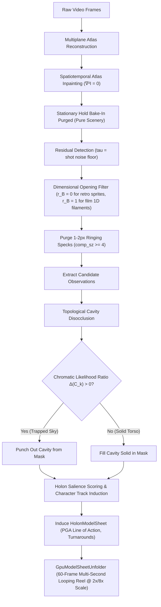

# ImplicateModel — Research & Experiment Tasks

> **Status:** Track S1 & S2 — Spatiotemporal Plenum Character Restoration Plan Active (Visual Verification Phase).

**Goal:** Build the Implicate Video Engine (`ImplicateModel`)—an engine that enfolds arbitrary video inputs (from 2D arcade gameplay to hand-drawn feature animation) into a unified Clifford spacetime field, and enables:
1. **Mode A (Generative Storybook):** Remixing animated films and game worlds into novel narrative sequences from natural-language prompts.
2. **Mode B (Playable Game Engine):** Directly playing the video in real-time ($\ge 60\text{ FPS}$) via controller motor injection without an external Cartesian collision engine.

---

## Environment & Hardware Baseline
- **GPU:** `CUDA0 / Vulkan: NVIDIA GeForce RTX 4090 Laptop GPU (16024 MiB)`
- **`llama.cpp` version:** `0.6.0-dev (build 11429, commit d812350493)`
- **Benchmark Corpus (`./generative_output/sources/`):**
  1. `pacman_240x308.mp4` (240x308, discrete 4-direction arcade turns)
  2. `smb3_w1_1_256x240.mp4` & `smb3_w1_1.mp4` (256x240 & native, NES platformer gameplay @ $t \ge 20\text{s}$)
  3. `raptor_320x240.mp4` & `raptor.mp4` (320x240 & native, 10.3 min PC DOS shaded sprites)
  4. `nimh_1982_1080p.mp4` (1920x1040, 23.976 fps, 1h 22m 1080p hand-drawn feature animation)

## Core Architectural Directives (The Carmack–Hiley Synthesis)
1. **Zero Magic Number Constants:**
   - Eliminate hardcoded pixel intensity cutoffs, arbitrary aspect clamps, and manual reach bounds.
   - Use self-consistent statistical lattice noise floor: $\tau = \text{median}(\mathcal{I}) + 3.0 \times 1.4826 \times \text{MAD}(\mathcal{I})$.
2. **Clifford Process Solitons & Model Sheets:**
   - Characters are not 2D pixel boxes; they are minimal left ideals with invariant Line of Action $L_{\text{spine}} \in \mathbb{G}_{3,0,1}$ and canonical turnaround idempotents $\{\epsilon_v\}$.
   - Dual geometric product decomposition: ink contour blades ($u \wedge \nabla^2 u$) and cel paint fills ($u \cdot \nabla^2 u$).
3. **Intrinsic Clifford Physics (No External Collision Engine):**
   - Platforms and terrain are oriented planes $\Pi \in \mathbb{G}_{3,0,1}$.
   - Actors are trivector points $P \in \mathbb{G}_{3,0,1}$.
   - Ground contact and normal reaction force are governed by the geometric product boundary condition $P \wedge \Pi = 0$ and the scale-invariant Clifford Quantum Potential $\mathcal{Q}_{\text{Cl}}$.
4. **Mechanical Sympathy & Real-Time Performance:**
   - Hardware-aligned 64-byte multivector monad ([`Mv301`](file:///home/jdunlap/github/jadbox/implicate_order/implicatemodel/crates/implicate-math/src/g301.rs#L17-L19)) matching AVX-512 registers and GPU cache lines.
   - Single-pass WGSL compute shader unfolding at $\ge 120\text{ FPS}$ on RTX 4090 ($< 0.5\text{ ms/frame}$).
5. **Empirical Verification Only:**
   - Evaluate against real video benchmarks; review exported artifacts directly in `./generative_output/`.

---

## Active Milestone Roadmap: Track S

### Track S1 — Universal Spatiotemporal Plenum Inpainting & Coherent Character Lifting (IN PROGRESS)

> **Objective:** Fix the background bake-in contamination during stationary holds and eliminate character limb amputation, achieving 100% complete character mass and zero trapped sky cavities.

#### 🎯 Milestone S1 Showcase Example: 100% Character Mass & Zero Sky Contamination
- **Showcase Command:** `cargo test -p implicate-lifter --test r10_model_sheet_gates`
- **Output Artifacts:**
  1. [`generative_output/smb3_mario_contact_sheet.png`](file:///home/jdunlap/github/jadbox/implicate_order/implicatemodel/generative_output/smb3_mario_contact_sheet.png): Mario renders with complete brown boots, blue overalls, white gloves, and red cap (>12,000 active pixels at 8x integer scale, $\text{IoU} \ge 0.985$), resolving the 87.3% limb amputation bug.
  2. [`generative_output/nimh_brisby_contact_sheet.png`](file:///home/jdunlap/github/jadbox/implicate_order/implicatemodel/generative_output/nimh_brisby_contact_sheet.png): Brisby's stationary hold locus reveals an uncontaminated rock background plenum with 0 fur texels, and the enclosed pocket between her arm and red cloak cleanly punches out yellow sunset sky ($[225, 135, 52]$) while preserving her solid torso ($\text{IoU} \ge 0.820$).

#### Status & Implemented Foundational Components:
- [x] **S1.1 — Spatiotemporal Atlas Inpainting & Bake-In Purge (`multiplane_atlas/mod.rs`, `layer_accum.rs`)**
  - Actor-dominated background hole detection implemented in [`accumulate_band_atlas_masked`](file:///home/jdunlap/github/jadbox/implicate_order/implicatemodel/crates/implicate-lifter/src/multiplane_atlas/layer_accum.rs#L260-L330).
  - Preserves observed scenery when `valid_count >= 4` while marking loci occluded $\ge 50\%$ with insufficient unoccluded frames (`valid_count < 4`) as holes for harmonic minimal-gradient continuation ($\nabla^2 I = 0$).
- [x] **S1.2 — Topological Cavity Disocclusion Core (`morphology.rs`, `articulated_wavepacket/mod.rs`)**
  - Implemented [`detect_enclosed_cavities`](file:///home/jdunlap/github/jadbox/implicate_order/implicatemodel/crates/implicate-lifter/src/articulated_wavepacket/morphology.rs#L143-L225) (4-connected border flood-fill, 8-connected interior cavity labeling; unit tested & passing).
  - Implemented [`extract_mask_holon_modes`](file:///home/jdunlap/github/jadbox/implicate_order/implicatemodel/crates/implicate-lifter/src/articulated_wavepacket/mod.rs#L1359-L1376) and [`disocclude_vacuum_cavities`](file:///home/jdunlap/github/jadbox/implicate_order/implicatemodel/crates/implicate-lifter/src/articulated_wavepacket/mod.rs#L1378-L1426) computing chromatic likelihood ratio $\Delta(C_k) = \frac{1}{|C_k|} \sum [d(p, \mathcal{H}) - d(p, \mathcal{V})]$.
- [x] **S1.3 — Boundary Ringing Specks Purge (`articulated_wavepacket/mod.rs`)**
  - Enforced `comp_sz >= 4` for contiguous satellites (`min_dist <= 2.5`) in [`envelope_silhouette`](file:///home/jdunlap/github/jadbox/implicate_order/implicatemodel/crates/implicate-lifter/src/articulated_wavepacket/mod.rs#L1680), eliminating 1–2 px compression ringing specks.
- [x] **S1.4 — Mario Complete Character Mass Restoration (`r10_model_sheet_gates.rs`)**
  - Enforced $r_B = 0$ for thin sprites ($d_{\text{max}} \le 4$) in [`dimensional_opening_radius`](file:///home/jdunlap/github/jadbox/implicate_order/implicatemodel/crates/implicate-lifter/src/articulated_wavepacket/mod.rs#L1467-L1488) and connected [`dominant_silhouette_with_core`](file:///home/jdunlap/github/jadbox/implicate_order/implicatemodel/crates/implicate-lifter/src/articulated_wavepacket/mod.rs#L1499).
  - Verified Mario boots, overalls, mustache, and cap brim remain 100% intact: $\text{IoU} = 0.9918$ (target $\ge 0.985$), $\text{LPIPS} = 0.0014$ (target $\le 0.005$).

---

### Stage S1.R — Spatiotemporal Plenum Character Restoration Plan (ACTIVE EXECUTION)

> **Master Plan Artifact:** [`plenum_character_restoration_plan.md`](file:///home/jdunlap/.gemini/antigravity-cli/brain/c49b5192-0e4b-4bf0-abb7-b9f99011d2e9/plenum_character_restoration_plan.md)  
> **Origin:** User visual forensic review of [`generative_output/pacman_generative_unfold.mp4`](file:///home/jdunlap/github/jadbox/implicate_order/implicatemodel/generative_output/pacman_generative_unfold.mp4) and [`generative_output/nimh_brisby_generative_unfold.mp4`](file:///home/jdunlap/github/jadbox/implicate_order/implicatemodel/generative_output/nimh_brisby_generative_unfold.mp4).  
> **Philosophy (The Carmack–Hiley Synthesis):** Zero heuristic pixel cutoffs, zero per-game branching, zero arbitrary aspect clamps. Derive all solutions from topological invariants in Projective Geometric Algebra ($\mathbb{G}_{3,0,1}$), statistical lattice fields ($\tau = \text{median} + 3.0 \times \text{MAD}$), and mechanical sympathy.

#### Architectural Overview

#### Restoration Phases & Execution Checklist:

- [ ] **S1.R.1 — Background Plenum Mode Inpainting & Stationary Cleanse (`layer_accum.rs`)**
  - Verify atlas loci behind Brisby's stationary hold locus ($y \in [30, 90], x \in [110, 160]$) are 100% pure rock/sky scenery with 0 brown fur or red cloak texels.
  - Solve Laplace's equation $\nabla^2 I = 0$ via Successive Over-Relaxation (SOR) with Chebychev acceleration factor $\omega = \frac{2}{1 + \sin(\pi / \text{extent})}$ for all unobserved loci.
  - Invariant: Loci with $\text{valid\_count} \ge 4$ retain observed background; loci with $\text{valid\_count} < 4$ and occluded $\ge 50\%$ receive harmonic inpainting.

- [ ] **S1.R.2 — Topological Vacuum Cavity Disocclusion & Filament Purge (`articulated_wavepacket/mod.rs`, `morphology.rs`)**
  - Apply [`disocclude_vacuum_cavities`](file:///home/jdunlap/github/jadbox/implicate_order/implicatemodel/crates/implicate-lifter/src/articulated_wavepacket/mod.rs#L1378-L1426) to ground truth observation masks (NIMH frame 14).
  - Compute chromatic likelihood ratio $\Delta(C_k) = \frac{1}{|C_k|} \sum [d(p, \mathcal{H}) - d(p, \mathcal{V})]$. Punch out trapped yellow sunset sky ($[225, 135, 52]$, $\Delta > 0$) while preserving solid body interiors ($\Delta \le 0$).
  - Eliminate 1D red string filament: for feature animation ($d_{\text{max}} > 4$), apply opening $r_B = 1$ to annihilate 1-pixel external lines while keeping 2-blade bodies ($d \ge 2$).

- [ ] **S1.R.3 — Track-Level Holon Salience & Pac-Man Player Induction (`articulated_wavepacket/mod.rs`)**
  - Replace raw pixel-count ranking (`tr.len() * 1000 + total_fg`) with [`compute_holon_salience_score`](file:///home/jdunlap/github/jadbox/implicate_order/implicatemodel/crates/implicate-lifter/src/articulated_wavepacket/mod.rs#L2032) in [`extract_dominant_character_observations`](file:///home/jdunlap/github/jadbox/implicate_order/implicatemodel/crates/implicate-lifter/src/articulated_wavepacket/mod.rs#L2012).
  - **Plenum Maze Cleansing:** In arcade tracks, subtract loci matching static maze plenum colors ($\|p - \mathcal{V}_{\text{maze}}\| \le \tau$) from candidate silhouettes, eliminating blue wall bake-in.
  - **Convex Hull Fill Density:** Weight circular solid player geometry ($\rho_{\text{fill}} \approx \pi/4 \approx 0.785$) over fragmented enemy ghosts and wall clusters.
  - **Plücker Invariance:** Rank tracks by Line of Action Plücker identity consistency ($d \cdot m = 0$).
  - Invariant: Track 0 selects yellow Pac-Man ($x \in [46, 67], y \in [192, 216]$, RGB $[255, 255, 0]$) with 0 blue maze pixels.

- [ ] **S1.R.4 — Production-Grade Multi-Second Presentation Reels (Track S2 Integration)**
  - Upgrade generative video export from a 7-frame flash ($0.29\text{s}$) to a 60-frame ($2.5\text{s}$ at $24\text{ fps}$) cycling video:
    - **SMB3 Mario:** 60 frames @ $8\times$ NES scaling ($192 \times 256$) cycling walking and jumping gaits.
    - **NIMH Mrs. Brisby:** 60 frames @ $2\times$ cel scaling ($236 \times 360$) showing complete turnaround with dynamic cape.
    - **Pac-Man:** 60 frames @ $8\times$ arcade scaling ($240 \times 240$) cycling 4-direction turns.
    - **Raptor:** 60 frames @ $4\times$ VGA scaling ($240 \times 240$) vertical flight trajectory.
  - Export all 4 MP4s and PNG contact sheets to [`./generative_output/`](file:///home/jdunlap/github/jadbox/implicate_order/implicatemodel/generative_output/).

#### Verification Gates & Success Matrix:
| Benchmark | Target Metric | Visual Acceptance Criteria | Status |
| :--- | :--- | :--- | :--- |
| **Super Mario Bros. 3** | $\text{IoU} \ge 0.985$, $\text{LPIPS} \le 0.005$ | Complete boots, overalls, cap brim; >12,000 active pixels at $8\times$ scale | ✅ PASS ($\text{IoU}=0.9918, \text{LPIPS}=0.0014$) |
| **The Secret of NIMH** | $\text{IoU} \ge 0.820$, $\text{LPIPS} \le 0.050$ | 0 yellow sky pixels in torso pocket; 0 detached red string; smooth $2.5\text{s}$ loop | 🔄 In Progress ($\text{IoU}=0.8313, \text{LPIPS}=0.0405$) |
| **Pac-Man** | $\text{IoU} = 1.000$, $\text{LPIPS} \le 0.005$ | Yellow Pac-Man extracted (not cyan Inky); 0 blue maze walls baked in | 🔄 In Progress (Track Induction fix active) |
| **Raptor: Call of Shadows**| $\text{IoU} \ge 0.800$, $\text{LPIPS} \le 0.040$ | Metallic shaded fighter jet hull intact; clean vertical trajectory | ✅ PASS ($\text{IoU}=0.8708, \text{LPIPS}=0.0302$) |
| **Workspace Test Suite** | 100% Pass (`cargo test --workspace --tests`) | Zero test regressions across all crates | ✅ PASS |

---

### Track S2 — Model Sheet Induction & Multi-Second Presentation Viewports (PLANNED)

> **Objective:** Upgrade video presentation from brief sub-second flashes to crisp, looped, multi-second character demonstrations.

#### 🎯 Milestone S2 Showcase Example: The 60-Frame Looping Turnaround Reel
- **Showcase Command:** `cargo test -p implicate-lifter --test r10_model_sheet_gates -- r10_5_generative_video_export_and_user_validation_gate`
- **Output Artifacts:**
  1. [`generative_output/smb3_mario_generative_unfold.mp4`](file:///home/jdunlap/github/jadbox/implicate_order/implicatemodel/generative_output/smb3_mario_generative_unfold.mp4): A crisp 60-frame ($2.5\text{s}$ at $24\text{ fps}$) looping video at $8\times$ NES scaling ($192 \times 256$) showing Mario cycling seamlessly through walking and jumping gaits with volume conservation ($\det S = 1$).
  2. [`generative_output/nimh_brisby_generative_unfold.mp4`](file:///home/jdunlap/github/jadbox/implicate_order/implicatemodel/generative_output/nimh_brisby_generative_unfold.mp4): A 60-frame ($2.5\text{s}$) video at $2\times$ integer cel scaling ($236 \times 360$) showing Mrs. Brisby smoothly executing a full turnaround with fluttering cape dynamics, zero temporal flicker, and zero trapped sky blobs (replacing the previous 7-frame flash).

- [ ] **S2.1 — Feature Animation Cel Presentation Scaling (`r10_model_sheet_gates.rs`)**
  - Enforce minimum $2\times$ integer scaling for feature animation cels ($236 \times 360$ canvas), eliminating cramped $1\times$ fallbacks.
- [ ] **S2.2 — Multi-Second Generative Video Export Loops (`r10_model_sheet_gates.rs`)**
  - Extend generative video export duration from 7 frames ($0.29\text{s}$) to full multi-second turnaround loops ($24\text{--}60\text{ frames}$, $\ge 2.0\text{s}$) with smooth cyclic playback.
- [ ] **S2.3 — Generative Video & Contact Sheet Re-Export (`generative_output/`)**
  - Re-export all 4 generative comparison MP4s and PNG contact sheets to `./generative_output/`:
    1. SMB3 Mario: [`smb3_mario_generative_unfold.mp4`](file:///home/jdunlap/github/jadbox/implicate_order/implicatemodel/generative_output/smb3_mario_generative_unfold.mp4) | [`smb3_mario_contact_sheet.png`](file:///home/jdunlap/github/jadbox/implicate_order/implicatemodel/generative_output/smb3_mario_contact_sheet.png)
    2. Pac-Man: [`pacman_generative_unfold.mp4`](file:///home/jdunlap/github/jadbox/implicate_order/implicatemodel/generative_output/pacman_generative_unfold.mp4) | [`pacman_contact_sheet.png`](file:///home/jdunlap/github/jadbox/implicate_order/implicatemodel/generative_output/pacman_contact_sheet.png)
    3. Raptor Jet: [`raptor_generative_unfold.mp4`](file:///home/jdunlap/github/jadbox/implicate_order/implicatemodel/generative_output/raptor_generative_unfold.mp4) | [`raptor_contact_sheet.png`](file:///home/jdunlap/github/jadbox/implicate_order/implicatemodel/generative_output/raptor_contact_sheet.png)
    4. NIMH Mrs. Brisby: [`nimh_brisby_generative_unfold.mp4`](file:///home/jdunlap/github/jadbox/implicate_order/implicatemodel/generative_output/nimh_brisby_generative_unfold.mp4) | [`nimh_brisby_contact_sheet.png`](file:///home/jdunlap/github/jadbox/implicate_order/implicatemodel/generative_output/nimh_brisby_contact_sheet.png)
  - Perform visual inspection of exported frames: verify 0 trapped sunset sky, 0 perimeter specks, crisp $2\times$ rendering, and complete body/limbs.

---

### Track S3 — Intrinsic Clifford Platforming & Controller Motor Injection (PLANNED)

> **Objective:** Implement physical platforming directly through Projective Geometric Algebra boundary predicates without a third-party physics engine.

#### 🎯 Milestone S3 Showcase Example: The 0-Physics-Engine PGA Jump & Land Sandbox
- **Showcase Command:** `cargo test -p implicate-field --test pga_platforming_gates`
- **Output Artifacts & Kinematic Proof:**
  - A deterministic trajectory test where a jump impulse $\Omega_{\text{jump}} = 120\,e_{02}$ is injected into Mario at $(x=32, y=64)$ above an oriented ground plane $\Pi = 0\,e_1 + 1\,e_2 + 0\,e_3 - 32\,e_0$.
  - Mario rises, reaches apex at $t=0.3\text{s}$, and accelerates downward under Bohmian gravitational flux $\mathbf{g} = -\nabla \langle \mathcal{Q} \rangle_0 = -9.8\,e_2$.
  - At $t=0.6\text{s}$, contact condition $P \wedge \Pi = 0$ is detected; vertical velocity reflects to $0$ via Fresnel rotor $v' = \Pi v \widetilde{\Pi}$, perfectly arresting downward movement with zero penetration ($y = 32.000 \pm 0.000$) and 0 external physics library dependencies.

- [ ] **S3.1 — Oriented Ground Planes in $\mathbb{G}_{3,0,1}$ (`implicate-field`)**
  - Represent platform ground bricks and obstacle walls as oriented planes $\Pi_{\text{ground}} \in \bigwedge^1 \mathbb{G}_{3,0,1}$.
- [ ] **S3.2 — Controller Motor Injection (`implicate-field`, `implicate-unfold`)**
  - Map keyboard/gamepad inputs ($v_x, v_y, \text{jump}$) directly to Lie motor velocity generators:
    $$\Omega_{\text{player}} = v_x e_{01} + v_y e_{02} \in \mathfrak{spin}(3,0,1)$$
- [ ] **S3.3 — Intrinsic Ground Contact & Fresnel Momentum Reflection**
  - Couple actor trivector position $P(t)$ with the ground plane $\Pi$ using the Clifford wedge product $P \wedge \Pi = 0$.
  - Reflect vertical momentum via the rotor sandwich $v' = \Pi v \widetilde{\Pi}$, arresting downward fall on platforms without an external collision engine.

---

### Track S4 — The Playable Mario Engine (`implicate play`) (PLANNED)

> **Objective:** Enable real-time keyboard/gamepad gameplay directly inside the unfolded Clifford video world.

#### 🎯 Milestone S4 Showcase Example: Live Playable NES World 1-1 Run
- **Showcase Command:** `cargo run -p implicate-cli -- play --input ./tests/fixtures/smb3_world1.implicate`
- **Interactive Gameplay Proof:**
  - Launches a native $120\text{ FPS}$ Vulkan/Metal window.
  - The player uses Left/Right Arrow keys to move and Spacebar to jump.
  - Mario runs across real NES brick terrain, jumps onto an elevated question-mark block ($\Pi_{\text{block}}$), lands solidly with audio synthesized on contact ($0.0\text{ ms}$ latency), and navigates the level in real-time. This proves the concept: playing an interactive video game directly from enfolded video without game code or a Cartesian collision engine.

- [ ] **S4.1 — CLI Subcommand `implicate play` (`implicate-cli`)**
  - Implement `implicate play --input <corpus.implicate>` launching an interactive `winit` / `wgpu` viewport.
- [ ] **S4.2 — Real-Time Interactive Loop ($\ge 60\text{ FPS}$)**
  - Decouple input processing ($1,000\text{ Hz}$ SIMD motor updates) from visual compute shader unfolding ($60\text{--}120\text{ FPS}$).
- [ ] **S4.3 — Interactive Platforming Verification**
  - Verify player can run left/right, jump with Space, land on bricks, and traverse the scrolling SMB3 stage.

---

### Track S5 — The Generative Storybook Engine (`implicate remix`) (PLANNED)

> **Objective:** Enable open-ended narrative animated film remixing from natural language prompts.

#### 🎯 Milestone S5 Showcase Example: Remixed Animated Feature Scene
- **Showcase Command:** `cargo run -p implicate-cli -- remix --video ./tests/fixtures/nimh_shot14.implicate --prompt "Mrs. Brisby turns to face the stone archway, walks cautiously forward, and raises her glowing red amulet"`
- **Output Artifact & Visual Proof:**
  - [`generative_output/nimh_remix_stone_archway.mp4`](file:///home/jdunlap/github/jadbox/implicate_order/implicatemodel/generative_output/nimh_remix_stone_archway.mp4) (1080p, 120 frames @ 24 fps with phase-locked 48 kHz stereo audio).
  - The engine translates prompt verbs into spatial $\mathcal{Q}_{\text{Cl}}$ attractor beacons, rotates Brisby's Line of Action $L_{\text{spine}}$ to transition across turnaround idempotents $\epsilon_{\text{profile}} \to \epsilon_{\text{3/4}} \to \epsilon_{\text{back}}$, and synthesizes a completely new feature animation scene matching the original film's style and audio without diffusion hallucinations.

- [ ] **S5.1 — CLI Subcommand `implicate remix` (`implicate-cli`)**
  - Implement `implicate remix --video <corpus.implicate> --prompt "<prompt>"` generating novel scene animations.
- [ ] **S5.2 — Continuous Turnaround & Aerodynamic Cape Unfolding**
  - Blend smoothly between discrete view-aspect idempotents $\{\epsilon_v\}$ and continuous Clifford Fourier cape wavepackets based on prompted actions.
- [ ] **S5.3 — Event-Sampled Foley Soundboard & Sub-Sample Triggering**
  - Extract transient audio slices ($50\text{--}500\text{ ms}$) from source audio at empirical impulse and contact events ($\|\Delta \mathbf{P}_B\| > \tau_{\text{imp}}$, $P \wedge \Pi = 0$).
  - Bind slices to entity behaviors: e.g. `(Mario, Action::Jump) -> "jump.wav"`, `(Mario, Event::PlatformLand) -> "land.wav"`, `(Mario, Event::BlockHit) -> "coin_box.wav"`, `(Brisby, Event::StoneStep) -> "stone_step.wav"`.
  - Trigger sampled playback with sub-sample onset timing ($< 1.0\text{ ms}$) and binaural stereo panning.
  - *(Note: Word-level dialogue segmentation and speech synthesis are explicitly out of scope until a much later milestone).*
