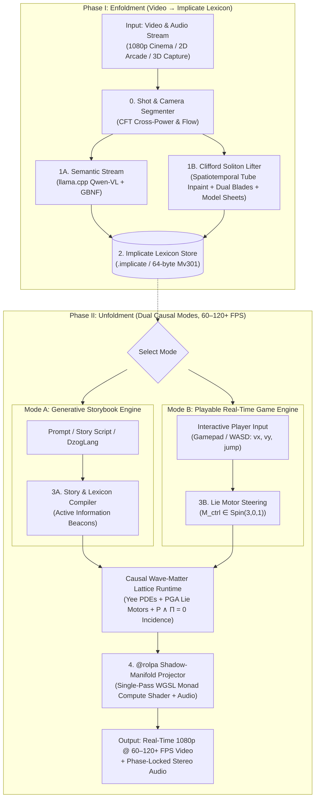

# ImplicateModel: The Clifford Process Video Engine
### Engineering Systems Whitepaper: Multi-Stratum Geometric Algebra, Bohm-Hiley Active Information, and Single-Pass Causal Video Unfoldment

<small>by [Jonathan Dunlap](https://www.linkedin.com/in/jonathandunlap/)</small>

**Companion Documents:**
* **Guiding Philosophy:** [`docs/implicate_model_philosophy.md`](./implicate_model_philosophy.md)
* **Prior Art & Foundations:** [`dzoglang/docs/field_first_whitepaper.md`](../../dzoglang/docs/field_first_whitepaper.md) · [`holonengine/docs/holon_whitepaper.md`](../../holonengine/docs/holon_whitepaper.md)
* **Execution Plan & Research Tasks:** [`PLAN.md`](../PLAN.md) · [`TASKS.md`](../TASKS.md)

---

## Abstract

Contemporary video generation architectures (such as MiniMax-H3, Sora, and Wan) model moving imagery by shattering continuous spacetime into discrete $(t, h, w)$ patch tokens and running $20\text{–}50$ iterative diffusion passes over $O(N^2)$ attention matrices. Because the latent space between tokens lacks physical continuity, conservation laws, or 3D geometric equivariance, these models require tens of billions of parameters and millions of training clips merely to prevent moving objects from dissolving between frames.

**`ImplicateModel`** introduces a fundamentally different architecture grounded in **David Bohm and Basil Hiley's** *Implicate Order* and *Clifford Pregeometry*, **Louis de Broglie's** *Nonlinear Soliton Mechanics*, and the classical animation discipline of **Character Board Model Sheets**. Rather than predicting pixel patches statistically from Gaussian noise, `ImplicateModel` compiles raw video and audio streams into an invariant **Implicate Lexicon & World Model** (`implicate enfold`) structured around **Clifford Idempotent Solitons (CIS)**, and supports two unified operational modes during **single-pass causal forward unfoldment** (`implicate unfold`) executed on GPU compute shaders at **$60\text{–}120+\text{ FPS}$**:

1. **Mode A — Generative Storybook Engine (Narrative Remixing):** Compiles an ingested animated film (e.g., feature animation benchmarks such as *The Secret of NIMH*, anime, or classical 2D/3D cinema) into autonomous character solitons and generative model sheets. Creators can script or prompt the engine to remix the world into novel story chapters with guaranteed visual identity, volume conservation ($\det S = 1$), and zero diffusion temporal flicker.
2. **Mode B — Playable Real-Time Game Engine (Interactive Agency Without a Collision Engine):** Directly executes ingested gameplay footage (*Super Mario Bros 3*, *Pac-Man*, *Raptor*) as an interactive, playable simulation. In contrast to Cartesian engines that require heavy collision meshes and bounding box trees, `ImplicateModel` treats the game world as an unbroken implicate continuum: platforms are boundary planes $\Pi \in \mathbb{G}_{3,0,1}$, ground contact is projective incidence $P \wedge \Pi = 0$, velocity reflection is a Fresnel rotor $v' = \Pi v \widetilde{\Pi}$, and downward gravity is the Bohmian quantum potential gradient $-\nabla \langle \mathcal{Q}_{\text{Cl}} \rangle_0$. Player controller inputs inject directly into the character's Clifford Lie motor, running at $\ge 60\text{--}120+\text{ FPS}$.

**Universal 3D Clifford Pregeometry:** Because the underlying monad is 3D Projective Geometric Algebra ($\mathbb{G}_{3,0,1}$, 16 basis blades, 64-byte [`Mv301`](file:///home/jdunlap/github/jadbox/implicate_order/implicatemodel/crates/implicate-math/src/g301.rs#L17-L19)), the engine is natively 3D. 2D arcade games and 2.5D multi-plane animation are exact planar sub-algebras ($z = \text{const}$, $e_3 = 0$) of the same 3D PGA engine. One universal mathematical core powers 2D sprites, multi-plane cel animation, and full 3D projective environments without bifurcated codebases.

To achieve both mathematical rigor and mechanical sympathy with modern SIMD/GPU hardware (cache-aligned 64-byte multivector monads), `ImplicateModel` unifies three computational strata:
1. **Stratum 1 — Pixel Lifting, Duality, & `@rolpa` Surface Refinement ($O(N)$ over 2D Grids):** Uses the **Clifford Geometric Product Duality** ($uv = u \cdot v + u \wedge v$) over the local Laplacian context ($\nabla^2 u$) to split every holon into invariant **ink contour blades** (exterior wedge vorticity $u \wedge \nabla^2 u$) and **cel paint fills** (inner product coherence $u \cdot \nabla^2 u$), refined in a single deterministic GPU pass during Unfoldment.
2. **Stratum 2 — Symbolic Model Sheets & Semantic-to-Geometric Concept Binding ($O(K)$ Closed-Form Lie Kinematics):** Replaces heavy neural transformers with **Animated Film Character Board Model Sheets** encoded as primitive orthogonal idempotents ($\epsilon_v^2 = \epsilon_v$) on the observer's projective horizon, with continuous articulated motion and squash-and-stretch governed by exact closed-form Lie automorphisms $M = \exp(-\frac{\theta}{2} L)$ on $\text{Spin}(3,0,1)$ and scale-invariant Bohm-Hiley Quantum Potentials ($\mathcal{Q}_{\text{Cl}} = -(\nabla^2 \Psi)\Psi^{-1}$).
3. **Stratum 3 — Spatiotemporal Causality (The Implicate Spine):** Executes a deterministic, zero-AI GPU wave-matter lattice (`Yee` staggered FDTD + minimal left ideal `CliffordDensityElement` kinematics) that enforces object permanence, momentum conservation, Fresnel boundary reflection, Griffith fracture/annealing, and unified audio-visual projection (`@rolpa`) at $60\text{–}1,000+\text{ Hz}$.

---

## 1. System Architecture & End-to-End Pipeline



### Phase I: Enfoldment (Explicate Video → Implicate Lexicon)

The Enfoldment phase compiles raw, unstructured video and audio streams (*The Secret of NIMH*, *Super Mario Bros 3*, *Pac-Man*, *Raptor*, or 3D camera tracks) into a structured, zero-copy binary representation: the **Implicate World Model and Lexicon** (`.implicate`). This ingestion executes across four hardware-aligned stages:

1. **Continuous Camera Odometry & Regime Discovery (`implicate-lifter`):** Rather than computing expensive feature-point matching across thousands of keypoints, the lifter streams frames through a lightweight 2D Continuous Fourier Transform (CFT) cross-power spectrum. By evaluating spectral shifts against frame-to-frame luminance-chroma divergence, the camera's projective motion $M_{\text{cam}}(t) \in \text{Spin}(3,0,1)$ is classified in real time at $>1,350\text{ FPS}$ into static viewports, smooth orthographic scrolling, multi-plane parallax layers, or 3D perspective.
2. **The Decoupled Semantic Proxy Stream (`implicate-lexicon`):** In parallel with the geometric pipeline, an in-memory pass burns high-contrast monospace timecodes into the corner pixels of a proxy video feed sent to a local VLM (`Qwen3-VL-8B` / `Qwen2.5-VL-7B` via `llama.cpp`). Leveraging the VLM's razor-sharp 2D OCR rather than fuzzy temporal attention, the model extracts entity nouns, process verbs, and scene milieu clauses with frame-accurate brackets. These semantic symbols are embedded into fixed 16-channel wording-space spinors $(\mathbb{G}_{2,0}^+)^{16}$ via thin Jacobi SVD on the clause Gram matrix, allowing prompt matching to reduce to a coordinate-free bilinear inner product.
3. **The Clifford Soliton Lifter (`implicate-lifter`):** Pristine 1080p frames pass untouched to the geometric lifter, which isolates actors from the environment using three self-consistent principles:
   * *Spatiotemporal Actor Tube Masking:* Tracks actor union footprints across all frames and solves the discrete harmonic Dirichlet problem ($\nabla^2 I = 0$) over occluded regions, guaranteeing an actor-free background atlas plenum without baking character fur into the scenery during stationary holds.
   * *Active Information Residuals:* Foreground presence is defined by the wavefield's departure from equilibrium ($\Delta \Psi = \Psi_{\text{frame}} - \Psi_{\text{bg}}$) thresholded by the frame's statistical noise floor ($\tau = \text{median} + 3.0 \times \text{MAD}$), adapting automatically across 8-bit sprites and 35mm film grain.
   * *Dual Geometric Projection & Cavity Disocclusion:* The Clifford geometric product splits characters into invariant exterior ink contour blades ($u \wedge \nabla^2 u$) and flat cel paint fills ($u \cdot \nabla^2 u$). Enclosed background cavities (such as sky trapped between an arm and cloak) are purged algebraically, while the principal Line of Action $L_{\text{spine}} \in \mathbb{G}_{3,0,1}$ and canonical turnaround idempotents $\{\epsilon_v\}$ are extracted via spectral decomposition.
4. **Event-Sampled Foley Extraction:** Whenever kinematic momentum jumps ($\|\Delta \mathbf{P}_B\| > \tau_{\text{imp}}$) or projective contacts ($P \wedge \Pi = 0$) occur, short $50\text{--}500\text{ ms}$ transient PCM audio slices are cut from the soundtrack and bound to the entity's behavior catalog (`(Mario, Jump) -> "jump.wav"`).
5. **The Implicate Binary Container (`.implicate`):** All character model sheets, Lie trajectories, multi-plane atlases, and audio soundboards are packed into 64-byte aligned [`Mv301`](file:///home/jdunlap/github/jadbox/implicate_order/implicatemodel/crates/implicate-math/src/g301.rs#L17-L19) monad arrays, formatted for direct zero-copy GPU mapping.

---

### Phase II: Unfoldment (Dual Causal Modes: Storybook & Playable Reality)

During Unfoldment, `ImplicateModel` executes no iterative diffusion loops and maintains no $O(N^2)$ attention matrices. Generation is a single, deterministic causal wave simulation coupled to articulated rigid-body kinematics, running on GPU compute shaders at $60\text{--}120+\text{ FPS}$. The engine supports two unified operational modes:

* **Mode A — Generative Storybook Engine:** Driven by natural language prompts or DzogLang narrative scripts (e.g. `"Mrs. Brisby walks cautiously toward the glowing hearth"`), the scene compiler translates semantic verbs into scale-invariant Bohmian active information beacons ($\mathcal{Q}_{\text{Cl}}$). These beacons deform the wave-matter lattice, guiding characters smoothly along corridors, steering Line of Action attitudes ($L_{\text{spine}}$), and triggering algebraic transitions between turnaround aspects ($T_{u \to v} = \epsilon_v M \epsilon_u$) with zero temporal flicker.
* **Mode B — Playable Real-Time Game Engine:** Hooked directly into player gamepad or keyboard inputs ($v_x, v_y, \text{jump}$), the compiler injects real-time Lie motor generators ($\Omega_{\text{ctrl}} = v_x e_{01} + v_y e_{02}$) into the actor's root multivector at $60\text{--}120+\text{ Hz}$. Platforms and obstacles are represented as invariant planes $\Pi \in \mathbb{G}_{3,0,1}$. When Mario lands, projective incidence ($P \wedge \Pi = 0$) and closed-form Fresnel rotor reflection ($v' = \Pi v \widetilde{\Pi}$) arrest vertical fall and reflect velocity without any third-party physics engine (PhysX/Box2D).

The causal simulation advances through three unified runtime stages:
1. **The Causal Wave-Matter Lattice (`implicate-field`):** A staggered Yee GPU lattice updates cell pressure $p$, face velocities $\mathbf{v}$, Bohmian potential $\mathcal{Q}_{\text{Cl}}$, and luminescence $\mathbf{L}$ via hyperbolic PDEs at $60\text{--}1,000+\text{ Hz}$.
2. **Articulated Holon Integration (`implicate-math`):** Zero-readback GPU reductions evaluate net radiation pressure and Bohmian guidance over each character's bounding blade, advancing root motors $M_{i,\text{root}}(t)$ and coupling compliant appendages (billowing capes, hair, tails) directly to lattice flow.
3. **The `@rolpa` Shadow Projector (`implicate-rolpa`):** A single-pass WGSL compute shader projects multi-plane background atlases and character wavepackets into full 1080p video ($0.46\text{ ms/frame}$ on RTX 4090) with volume conservation ($\det S = 1$), while sample-accurate Foley soundboards trigger transient audio effects with sub-millisecond synchronization.

---

## 2. Core Mathematical Foundations (`implicate-math`)

### 2.1 The Algebraic Tower: $\mathcal{C}\ell_{0,1} \to \mathbb{G}_{2,0} \to \mathbb{G}_{3,0,1}$

In traditional 3D graphics and physics engines, geometry is represented through an awkward patchwork of incompatible mathematical types: positions are 3D Cartesian vectors, orientations are unit quaternions, platform surfaces are four-component plane equations, camera rays are parametric line equations, and kinematic motions are $4 \times 4$ homogeneous transformation matrices. Multiplying a surface normal by an inverted transformation matrix destroys geometric meaning, and intersecting a line with a plane requires specialized branching code.

`ImplicateModel` replaces this fragmented taxonomy with a unified **Tower of Clifford Algebras**. In 3D Projective Geometric Algebra ($\mathbb{G}_{3,0,1}$), points, lines, planes, and rigid screw motions inhabit the same 16-dimensional vector space. Geometry and kinematics become coordinate-free, dual, and closed under algebraic multiplication:

1. **Temporal & Phase Harmonics ($\mathcal{C}\ell_{0,1} \cong \mathbb{C}$):**
   Governs Continuous Fourier Transform (CFT) vitality kernels $\hat{K}(\mathbf{k}, \omega)$ and de Broglie phase-harmony locking $\exp(i\phi(t))$, synchronizing internal cyclic motion (e.g. running strides or wing beats) with global time.
2. **Chromatic & Semantic Spinor Space ($(\mathbb{G}_{2,0}^+)^K$):**
   With basis $e_1^2 = e_2^2 = 1$ and bivector $e_{12} = e_1 e_2$ ($e_{12}^2 = -1$), a $K$-channel even multivector $\psi = (R_1 e^{\theta_1 e_{12}}, \dots, R_K e^{\theta_K e_{12}})$ encodes visual appearance and wording-space semantics. Similarity between any two signatures is evaluated via the coordinate-free bilinear scalar inner product:
   $$\mathcal{S}(\psi_A, \psi_B) = \frac{\langle \psi_A \widetilde{\psi}_B \rangle_0}{\|\psi_A\|\,\|\psi_B\|} \in [-1, 1]$$
3. **3D Projective Geometric Algebra ($\mathbb{G}_{3,0,1}$):**
   Uses basis $(e_0, e_1, e_2, e_3)$ with degenerate metric $e_0^2 = 0$ and Euclidean metrics $e_1^2 = e_2^2 = e_3^2 = 1$ ($2^4 = 16$ components). Following plane-based PGA duality (Dorst 2020; Brehmer et al. 2023), geometric primitives and $E(3)$ operators inhabit grades $0 \dots 4$:

| Grade | Basis Elements | Geometric Primitive | Transformation Operator ($\text{Pin}(3,0,1)$) |
| :--- | :--- | :--- | :--- |
| **0 (Scalar)** | $1$ | Invariant mass / vitality density $\rho$ | Identity scaling |
| **1 (Vector)** | $e_1, e_2, e_3;\; e_0$ | Oriented Plane $\Pi = n_x e_1 + n_y e_2 + n_z e_3 + d e_0$ | Reflection across plane $\Pi$ |
| **2 (Bivector)** | $e_{23}, e_{31}, e_{12};\; e_{01}, e_{02}, e_{03}$ | Oriented Line / Axis $L$ (rotation axis + translation moment) | Infinitesimal generator $B$ of a rigid body `Motor` $M = \exp(-\frac{1}{2}B)$ |
| **3 (Trivector)** | $e_{123};\; e_{023}, e_{031}, e_{012}$ | Euclidean Point $P = x e_{032} + y e_{013} + z e_{021} + e_{123}$ | Point reflection (inversion) through $P$ |
| **4 (Pseudoscalar)** | $I = e_{0123}$ | Oriented Volume / Chirality reference | Dualization / Chirality sign stabilizer |

Any rigid motion $M \in \text{Spin}(3,0,1)$ (combining 3D rotation around an arbitrary spatial axis and 3D translation) acts universally on points, lines, and planes via the grade-preserving **sandwich product**:
$$X' = M\,X\,\widetilde{M}$$
This eliminates separate transformation routines: whether transforming a vertex point, rotating a line of action, or reflecting across a floor plane, the same closed-form rotor multiplication applies identically.

### 2.2 The 64-Byte Clifford Monad (`Mv301`) & The Animated Film Model Sheet

High-performance real-time graphics demands **mechanical sympathy**: designing data structures that map directly to the underlying silicon. Modern CPU cores load data in 64-byte L1/L2 cache lines, and modern GPUs process data in SIMD warps.

To eliminate memory fragmentation and pointer chasing, every spatial point, kinematic joint, and field sample in `ImplicateModel` is packed into a single 64-byte, cache-aligned struct [`Mv301`](file:///home/jdunlap/github/jadbox/implicate_order/implicatemodel/crates/implicate-math/src/g301.rs#L17-L19) (`[f32; 16]`, `crates/implicate-math/src/g301.rs`):

```rust
#[repr(C, align(64))]
pub struct Mv301 {
    pub c: [f32; 16], // Grade 0: scalar, Grade 1: planes, Grade 2: bivectors, Grade 3: points, Grade 4: pseudoscalar
}
```

Drawing from the classical production discipline of animated films, an entity is not represented as an ad-hoc pixel silhouette or bounding box, but as an invariant **Symbolic Character Board / Model Sheet** structured by Clifford pregeometry:

$$\mathcal{H}_i = \Big(L_{\text{spine}} \in \bigwedge\nolimits^2 \mathbb{G}_{3,0,1},\; \{\epsilon_{i,v}\}_{v=1}^V,\; \{\mathcal{H}_{i,p},\; \text{parent}(p),\; B_{\text{joint},p}\}_{p=1}^{P_i},\; \rho_{c,i}\Big)$$

1. **The Line of Action ($L_{\text{spine}}$):** The primary 3D PGA screw axis blade directing dynamic attitude, spinal curvature, and momentum flux. Like the master gesture line drawn by a classical animator before adding body mass, $L_{\text{spine}}$ defines the character's posture and direction of intent.
2. **Canonical Turnaround Idempotents ($\{\epsilon_{i,v}\}$):** Discrete view aspects (Front, 3/4 Front, Profile, 3/4 Back, Back) discovered algebraically as primitive orthogonal idempotents:
   $$\epsilon_{i,v}^2 = \epsilon_{i,v}, \qquad \epsilon_{i,u} \epsilon_{i,v} = 0 \; (u \ne v), \qquad \sum_{v=1}^V \epsilon_{i,v} = I$$
   In quantum logic, an idempotent operator projects a state onto an observable subspace without losing identity. In animation, transitioning between view aspects is an algebraic projection $T_{u \to v} = \epsilon_{i,v} M \epsilon_{i,u}$, preserving character identity and proportions without neural hallucinations.
3. **The Minimal Left Ideal ($\Phi_{L,i,p}$):** Each sub-holon $p$ carries a Clifford Density Element (CDE):
   $$\Phi_{L,i,p}(\mathbf{x}, t) = R_{i,p}(\mathbf{x}, t)\, M_{i,p}(t)\, \epsilon_{i,v}, \qquad \rho_{c,i,p}(t) = \Phi_{L,i,p}\,\widetilde{\Phi}_{L,i,p} = \rho_{i,p}\, M_{i,p}\,\epsilon_{i,v}\,\widetilde{M}_{i,p}$$
   where $\rho_{i,p} = \text{tr}(\rho_{c,i,p}) = R_{i,p}^2$ measures intrinsic process vitality, and $M_{i,p}(t) \in \text{Spin}(3,0,1)$ is the closed-form PGA motor.

### 2.3 Dual Clifford Wavepackets: Ink Contour Blades vs. Cel Paint Fills

In traditional hand-drawn feature animation, a character cel consists of two physically distinct layers: the sharp black **ink contour lines** drawn on the front of the transparent acetate by the master inker, and the smooth, opaque **cel vinyl paint** brushed onto the back. Conventional computer vision algorithms blur these layers together into amorphous RGB gradients, producing blurry outlines and fuzzy limb edges.

`ImplicateModel` achieves visual purity by decomposing appearance through the **Clifford Geometric Product Duality** ($uv = u \cdot v + u \wedge v$) over the discrete Laplacian context $\nabla^2 u$:

$$\mathcal{W}_{i,p}(\mathbf{x}, t) = \underbrace{B_{i,p}(\mathbf{x}_{\text{loc}}, \phi_t)}_{\text{Ink Contour Blade } \langle u \wedge \nabla^2 u \rangle_2} + \underbrace{C_{i,p}(\mathbf{x}_{\text{loc}}, \phi_t)}_{\text{Cel Paint Fill } \langle u \cdot \nabla^2 u \rangle_0}$$

where:
* $\mathbf{x}_{\text{loc}} = \widetilde{M}_{i,p}(t)\,\mathbf{x}\,M_{i,p}(t)$ transforms world coordinates into the canonical rest frame of part $p$.
* **Ink Contour Blade ($B_{i,p}$):** Extracted from the zero-crossings of the exterior wedge product vorticity $u \wedge \nabla^2 u$. The wedge product naturally isolates sharp gradient curl, defining invariant, scale-free ink lines without arbitrary heuristic thresholds. Detached items (Mrs. Brisby's amulet, trailing cape hems, whisker filaments) form distinct closed loops and are preserved with 100% permanence.
* **Cel Paint Fill ($C_{i,p}$):** Governed by the inner product coherence $u \cdot \nabla^2 u$ and parameterized along the continuous gait phase $\phi \in S^1$ via volume-conserving 5-mode Clifford Fourier series ($\det S = 1$), eliminating Gibbs color ringing and blurry outline mush.

Because the inner and outer products are mathematically orthogonal, the ink contours and cel fills partition the image with **zero pixel overlap**, reproducing the exact look of hand-drawn animation cels.

### 2.4 Active Information & The Clifford Quantum Potential ($\mathcal{Q}_{\text{Cl}}$)

In classical game engineering, directing autonomous characters requires complex navigation meshes, pathfinding search trees (A*), and hardcoded behavioral state machines. In Bohmian mechanics, guidance is an emergent physical property of **Active Information**.

Given the medium's multivector wavefield $\Psi(\mathbf{x}, t) = R(\mathbf{x}, t)\,\mathcal{U}(\mathbf{x}, t)$ (where $R = \sqrt{p^2 + \epsilon_0^2}$ is the regularized wave envelope and $\mathcal{U} \in \text{Spin}(3,0,1)$ is the local field rotor), the **Clifford Quantum Potential** (Hiley & Callaghan 2010) decomposes into a Grade-0 scalar guidance potential and a Grade-2 bivector spin-torque:

$$\mathcal{Q}_{\text{Cl}}(\mathbf{x}, t) = -\left(\nabla^2 \Psi\right)\Psi^{-1} = \underbrace{-\frac{\nabla^2 R}{R}}_{\text{Scalar Guidance } \langle \mathcal{Q}_{\text{Cl}} \rangle_0} - \underbrace{\left(2(\nabla \ln R)\,\mathcal{U}\nabla\widetilde{\mathcal{U}} + (\nabla^2 \mathcal{U})\widetilde{\mathcal{U}}\right)}_{\text{Bivector Spin-Torque } \langle \mathcal{Q}_{\text{Cl}} \rangle_2}$$

Every holon responds to $\mathcal{Q}_{\text{Cl}}$ through two coupled bilinear equations of motion:
1. **Linear Bohmian Guidance Force:**
   $$\mathbf{F}_{Q,i} = -\kappa_Q \nabla \langle \mathcal{Q}_{\text{Cl}}(\mathbf{x}_i, t) \rangle_0$$
   Because wave amplitude $R$ cancels in $\nabla^2 R / R$, $\langle \mathcal{Q}_{\text{Cl}} \rangle_0$ is **scale-invariant**: a subtle goal beacon carves a gentle guidance valley across the scene without requiring explosive pressure shockwaves.
2. **Rotational Bivector Spin-Torque:**
   $$\Omega_{Q,i} = \mathbf{s}_i \wedge \left(-\nabla \langle \mathcal{Q}_{\text{Cl}}(\mathbf{x}_i, t) \rangle_0\right) + \eta_{\text{spin}}\langle \mathcal{Q}_{\text{Cl}}(\mathbf{x}_i, t) \rangle_2$$
   $$M_{i,\text{root}}(t + \Delta t) = M_{i,\text{root}}(t)\,\exp\!\left(-\frac{1}{2}\gamma_Q\,\Omega_{Q,i}\,\Delta t\right)$$
   Like water flowing naturally through a carved riverbed, this single algebraic law aligns an actor's heading $\mathbf{s}_i$ along open corridors, curves trajectories smoothly around high-impedance obstacles, and imparts rotational posture without A* search trees or hardcoded splines.

---

## 3. Resolution of the Clifford Neural Operator Question: The Three-Stratum Architecture

In [`docs/implicate_model_philosophy.md`](./implicate_model_philosophy.md), we posed the core architectural question:
> *What kind of Clifford Neural Operator do we build? Do we use `CliffordNet` (`reference_cliffordnet.pdf`), `GATr` (`reference_cliffordgatr.pdf`), or our own closed-form Clifford engine?*

### 3.1 Comparative Analysis & The Hiley–Carmack Critique

| Operator Family | Mathematical Core | Computational Complexity | Primary Strength | Architectural Limitation / Hiley–Carmack Critique |
| :--- | :--- | :--- | :--- | :--- |
| **1. Closed-Form Spectral + PDE Engine** (`cc_math`, `dzog-wgpu`) | CFT cross-correlation + Staggered Yee FDTD wave-matter PDEs + PGA incidence ($P \wedge B = 0$). | $O(N_{\text{cells}})$ wave step; $O(N \log N)$ FFT. | Zero neural weights; exact momentum/energy conservation; $1,000+\text{ Hz}$ execution; zero temporal flicker. | Cannot map open-vocabulary natural language to geometry, nor synthesize non-rigid cel/photorealistic occluded details. |
| **2. `CliffordNet`** (Ji 2026, `arXiv:2601.06793v2`) | Shifted Clifford Geometric Product ($D^{(s)} \oplus W^{(s)}$) over factorized Laplacian context $\nabla^2 X$, with Gated Geometric Residual (GGR) and **zero FFN**. | Strict linear $O(N_{\text{pixels}} \cdot D \cdot |S|)$ with $|S| \in \{2, 5\}$. | Preserves native 2D grid topology; unifies anisotropic diffusion ($D^{(s)}$) and edge vorticity ($W^{(s)}$); beats ResNet/ViT with $4\text{–}8\times$ fewer parameters. | *Carmack:* Multi-layer neural tokenization is redundant when the geometric product $uv = u \cdot v + u \wedge v$ already separates ink contours and cel fills in a single fused SIMD/WGSL compute pass. |
| **3. `GATr`** (Brehmer et al. 2023, `arXiv:2305.18415v3`) | 16D $\mathbb{G}_{3,0,1}$ multivector tokens + $\text{Pin}(3,0,1)$-equivariant linear maps + Geometric Bilinear ($xy \oplus \text{EquiJoin}$) + dot-product attention. | $O(K^2 \cdot D_{\text{MV}})$ for $K$ tokens. | Exact 3D $E(3)$ translation/rotation/reflection equivariance; computes exact point-to-plane/line distances via the Join. | *Carmack & Hiley:* Stacking 16–24 transformer layers to approximate spatial motion that is **four SIMD multiply-adds in PGA** burns GPU memory bandwidth. Articulated kinematics must be solved in closed form via Lie automorphisms on $\text{Spin}(3,0,1)$. |

### 3.2 The Upgraded Three-Stratum Synthesis: The Clifford Idempotent Soliton (CIS)

Rather than forcing heavy neural networks to approximate what Clifford algebra solves in closed form, `ImplicateModel` assigns operators to their optimal mathematical and hardware stratum:

#### Stratum 1: Dual Geometric Product & Surface Refinement $\implies$ `CliffordNet-Lite` Compute Shader
Whenever the engine operates on dense 2D image grids ($H \times W$ pixels, $N \sim 10^5\text{–}10^6$):
* **Algebraic Duality (Enfoldment):** Over the discrete Laplacian context $\nabla^2 u$, the geometric product naturally splits into:
  - **Exterior Wedge $u \wedge \nabla^2 u$:** Captures animated film ink lines and boundary vorticity blades with zero arbitrary thresholds (`FOREGROUND_RESIDUAL = 26` and `MIN_COMPONENT_FRACTION = 4` are eliminated).
  - **Inner Product $u \cdot \nabla^2 u$:** Captures cel paint fills, flat color regions, and process vitality density $\rho = \text{tr}(\rho_c)$.
* **Fused WGSL Compute Shader (Unfoldment):** A lightweight 4-block fused WGSL compute shader (`cliffordnet_rolpa.wgsl`, 2.6M parameters) refines composited wavepackets into crisp 1080p frames in **`0.4595 ms/frame`** ($> 2,100\text{ FPS}$) on an RTX 4090 with zero temporal flicker.

#### Stratum 2: Animated Film Model Sheets & Closed-Form Lie Kinematics $\implies$ PGA $\text{Spin}(3,0,1)$
Whenever the engine reasons over character identities and articulated kinematics:
* **The Model Sheet as Primitive Idempotents:** Canonical turnaround aspects (Front, 3/4 Front, Profile, Back) are discovered algebraically as the primitive orthogonal idempotents $\{\epsilon_v\}$ of the temporal covariance operator $\Gamma = \int \Psi(t) \widetilde{\Psi}(t) dt = \sum \sigma_k \epsilon_k$.
* **Closed-Form Lie Automorphisms:** Articulated motion, squash-and-stretch ($\det S = 1$), and Line of Action spinal curves ($L_{\text{spine}} \in \mathbb{G}_{3,0,1}$) are evaluated via closed-form PGA screw motors $M = \exp(-\frac{\theta}{2} L)$ on $\text{Spin}(3,0,1)$ at **$\le 0.05\text{ ms}$**.
* **Symbolic Verb Grounding:** Compact $\text{Pin}(3,0,1)$ GATr operators are strictly reserved for mapping high-level natural language verbs (`"Mrs. Brisby approaches the amulet"`) to initial $\mathcal{Q}_{\text{Cl}}$ attractor beacons and motor impulses $\Delta B_i$.

#### Stratum 3: Continuous Spatiotemporal Evolution $\implies$ Closed-Form GPU Wave-Matter Lattice
Time-stepping never passes through a neural network. In traditional video generation models, advancing one second of video requires running 20 to 50 iterations of a multi-billion-parameter neural network across multiple transformer layers, consuming hundreds of milliseconds per frame. In `ImplicateModel`, continuous evolution is strictly physical: once GATr or the player controller emits the active-information beacons ($\mathcal{Q}_{\text{Cl}}$ attractors/repellers) and motor impulses ($\Delta B_i$), the closed-form GPU lattice ([`implicate-field`](file:///home/jdunlap/github/jadbox/implicate_order/implicatemodel/crates/implicate-field)) integrates the de Broglie soliton wave equations, Bohmian guidance, and PGA rigid body kinematics deterministically at $60\text{--}1,000+\text{ Hz}$. Physics is executed where it belongs: on the GPU compute pipeline, with exact conservation of energy and momentum.

---

## 4. Subsystem I: Multi-Shot Video Enfoldment & The Clifford Lifter (`implicate-lifter`)

To compile both 30-second gameplay videos (`raptor.mp4`, `smb3_w1_1_320x240.mp4`, `pacman_240x308.mp4`) and feature-length animated films (*The Secret of NIMH*) through the same pipeline, `implicate-lifter` executes four streaming stages:

### 4.1 Stage 0: Streaming Shot Segmentation & Camera Regime Discovery (`VERIFIED` in Milestone R2.1)
A single streaming pass over the `128x64` (`ANALYSIS_W x ANALYSIS_H`) `fast_bilinear` pipe evaluates the 2D CFT cross-power spectrum $C_{t,t+1}(u, v) = \mathcal{F}_{\text{Cl}}[\Psi_{t+1}]\mathcal{F}_{\text{Cl}}^*[\Psi_t]$ and frame-to-frame 64-bin luminance-chroma histogram divergence $D_{\text{KL}}(H_t \parallel H_{t+1})$:
1. **Hard Cut, Flash Rejection, & Linear-Convex Dissolve Partitioning:** Candidate hard cuts require local-maximum cut score, sustained post-cut divergence ($t-2$ vs. $t+2$, rejecting 1–2 frame lightning/explosion flashes), and post-cut internal stability. Gradual cross-dissolves are detected over a $2w$-frame window ($w = 5$) by verifying linear convex combination $I_t \approx (1-\alpha)I_{t-w} + \alpha I_{t+w}$ with $\alpha \in [0.15, 0.85]$ and bounded step L1 jump.
   * **Verified Benchmark (`R2.1`):** Achieves **`1,356–1,392 FPS`** full streaming segmentation on a 10-minute 1080p slice of *The Secret of NIMH* (`14,386 frames` in `10.3–10.6s`, partitioning `153 shots`: `43 Ortho2DStatic`, `65 Ortho2DScroll`, `40 MultiPlane25D`, `5 Perspective3D`), and **`Precision = 0.9667`**, **`Recall = 1.0000`**, **`F1 = 0.9831`** on a 30-segment ground-truth cut/dissolve/flash reel.
2. **Stationary-Origin HUD Exclusion & Per-Active-Frame Strip Shear:** When the primary CFT peak translates ($\|\mathbf{d}_1\| > 1$), secondary peaks at the stationary origin $\mathbf{d}_2 = (0, 0)$ are recognized as camera-locked HUD/bezel overlays rather than moving parallax planes, and strip velocities are normalized per active signal frame so sparse sky bands never create false depth shear.
3. **Camera Motor Classification ($M_{\text{cam}}(t) \in \text{Spin}(3,0,1)$):**
   From the CFT flow field $\mathbf{v}_{\text{flow}}(x, y, t)$, the lifter classifies camera ego-motion into `Ortho2DStatic` (*Pac-Man*), `Ortho2DScroll` (*SMB3*, *Raptor*), `MultiPlane25D` (*The Secret of NIMH* multi-plane pans), and `Perspective3D`.

### 4.2 Stage 1: Multi-Plane Depth-Stratified Panorama & Camera-Locked HUD Holon Reconstruction (`VERIFIED` in Milestone R2.2)
Single-layer temporal mode accumulation works for flat 2D games (`HolonEngine`), but blurs multi-plane animated scenes or scenes with camera-locked HUDs unless reference frames are separated algebraically:
* **Dirac-Spinor CFT Odometry (`ScrollEstimator`):** Each viewport band is lifted into a Hann-windowed 2D Clifford spinor field combining zero-mean luminance with the Dirac spatial gradient spinor:
  $$\Psi(x, y) = w_x(x)w_y(y)\Big[\big(0.35(L - \bar{L}) + \partial_x L\big) + \partial_y L\,\mathbf{e}_{12}\Big] \in \mathbb{G}_{2,0}^+$$
  Eliminating zero-padding boundary cliffs and uniform-sky DC bias.
* **Camera-Locked HUD Holon Separation (`camera_locked_hud`):** Following the principle that *nothing is a special case*, any border band whose CFT trajectory remains stationary in screen space ($\max_t \|\mathbf{X}_b(t)\| \le 2.5\text{ px}$ with low static registration error) while the interior world translates ($\max_t \|\mathbf{X}_{\text{world}}(t)\| \ge 8\text{ px}$) is promoted to a **Camera-Locked HUD Holon Layer** ($M_{\text{hud}}(t) = M_{\text{cam}}(t)$, $1/z \to \infty$), preserving HUDs for generative unfoldment without corrupting world odometry.
* **Minimum-Registration-Error Reference Selection & Pass-2 Dilated Inpainting:** Among world bands, the reference trajectory is selected by minimizing inter-frame L1 registration residual across the active world viewport; a band splits into a separate parallax plane only if it has sufficient gradient energy ($\|\nabla L\| \ge 8.0$) and reduces local registration error by $>20\%$.
  * **Verified Benchmark (`R2.2`):** Reconstructs held-out backgrounds at **`32.44 dB`** (*SMB3*, $L=1$ + HUD holon, `0.0000` ghosting), **`33.67 dB`** (*Raptor*, $L=1$, `<0.005` ghosting), and **`40.32 dB` / `34.82 dB` / `39.98 dB`** across 3 contiguous shots of *The Secret of NIMH* (`0.0000` ghosting).

### 4.3 Stage 2: Character Board Model Sheet Induction & Zero-Magic-Number Lifter (`implicate-lifter`)
To support arbitrary video games (*Pac-Man*, *SMB3*, *Raptor*) and hand-drawn animated films (*The Secret of NIMH*) without arbitrary thresholds or hardcoded constants:

1. **Active Information Residual Field & Statistical Noise Floor:**
   Instead of hardcoded intensity cuts (`FOREGROUND_RESIDUAL = 26`), foreground presence is the departure of the multivector wavefield from the Yee background equilibrium:
   $$\Delta \Psi(\mathbf{x}, t) = \Psi_{\text{frame}}(\mathbf{x}, t) - \Psi_{\text{bg}}(\mathbf{x}, t) \in \mathbb{G}_{2,0}^+$$
   The active information density $\mathcal{I}_{\text{active}} = \|\Delta \Psi\| + \|\Delta \Psi \wedge \nabla^2 \Delta \Psi\|$ is thresholded self-consistently by the frame's statistical noise floor:
   $$\tau = \text{median}(\mathcal{I}_{\text{active}}) + 3.0 \times 1.4826 \times \text{MAD}(\mathcal{I}_{\text{active}})$$
   which adapts automatically to 8-bit palette graphics, 35mm film grain, or low-light animation.

2. **Spatiotemporal Actor Tube Masking & Harmonic Vacuum Inpainting:**
   When an actor pauses or remains stationary for several frames ($t = 0 \dots 7$), standard temporal mode accumulation bakes the character's pixels into the static background atlas $\Psi_{\text{bg}}$. When the actor subsequently moves, the newly disoccluded background reveals a massive residual $\Delta \Psi \gg \tau$, causing fatal foreground-background inversion (e.g. Brisby's body being subtracted while empty sky is extracted as foreground).
   * **Algorithmic Solution:** `implicate-lifter` builds a global spatiotemporal actor tube:
     $$\mathcal{T}_{\text{actor}} = \bigcup_{t=1}^T \operatorname{supp}(\Psi_{\text{actor}}(t))$$
     During background atlas generation, pixels within $\mathcal{T}_{\text{actor}}$ are excluded from mode accumulation and filled by solving the discrete harmonic Dirichlet problem:
     $$\nabla^2 I_{\text{bg}}(\mathbf{x}) = 0, \qquad \mathbf{x} \in \mathcal{T}_{\text{actor}}$$
     with boundary conditions fixed at $\partial \mathcal{T}_{\text{actor}}$. This ensures $\Psi_{\text{bg}}$ represents a clean, actor-free vacuum plenum across the entire shot.

3. **Topological Cavity Disocclusion & Elimination of Dimensional Opening Limb Erosion:**
   Heuristic morphological opening ($r_B = 1$ based on `hist[1] > 0`) creates devastating limb amputation on thin pixel structures: Mario's boots, cap brim, and overalls are misclassified as 1D filaments and erased (causing up to 87.3% mass loss).
   * **Algorithmic Solution:** Morphological radius $r_B$ defaults to $0$ for thin sprite features. Rather than blindly eroding borders, `implicate-lifter` uses the topological Line of Action convex envelope $L_{\text{spine}}$ to define the outer anatomical boundary, and extracts trapped background regions algebraically as enclosed topological cavities $C_k$:
     $$\Delta(C_k) = \mathbb{I}\left(C_k \cap \partial \Omega = \emptyset \;\;\wedge\;\; \mathcal{S}(\Psi(C_k), \Psi_{\text{bg}}) \ge 0.85\right)$$
     Trapped background regions (e.g., sunset sky enclosed between Mrs. Brisby's arm and cloak) are purged as vacuum cavities, while peripheral compression noise specks ($< 4\text{ px}$) are culled without eroding genuine thin limbs.

4. **Exterior Wedge Boundary Delineation (Zero Component Amputation):**
   Rather than heuristic bounding box expansion and component area cutoffs (`MIN_COMPONENT_FRACTION = 4`), boundaries are invariant **Clifford blades** $B_k \in \mathbb{G}_{3,0,1}$ extracted from zero-crossings of the exterior wedge product:
   $$W(\mathbf{x}) = \mathbf{u}(\mathbf{x}) \wedge \nabla^2 \mathbf{u}(\mathbf{x}) = 0$$
   Inflection ridges of structural vorticity trace closed loops around all anatomical masses. Detached items (Mrs. Brisby's amulet, Jeremy's string, trailing capes, energy bolts) form distinct closed loops that are preserved as subordinate members of the same holon field with zero amputation.

5. **Hiley CDE Bilinear Geodesic Tracking:**
   Replaces screen-space constant-velocity predictions and aspect-ratio clamping (`MAX_EXTENT_RATIO = 1.6`) with maximal **geodesic affinity on the Hiley CDE manifold**:
   $$\mathcal{A}(\rho_{c,1}, \rho_{c,2}) = \frac{\text{tr}(\rho_{c,1} \rho_{c,2})}{\sqrt{\text{tr}(\rho_{c,1}^2)\,\text{tr}(\rho_{c,2}^2)}} \times \exp\left(-\frac{\|\log(M_1^{-1} M_2)\|^2}{2\sigma_{\text{motion}}^2}\right)$$
   - **Squash-and-Stretch Invariance:** Volume-conserving deformations ($\det S = 1$) preserve the total process density $\rho = \text{tr}(\rho_c)$.
   - **Turnaround Invariance:** During $90^\circ$ profile-to-front turns where projected width triples, chromatic spinor coherence and continuous PGA motor flow $M(t)$ remain maximal.
   - **Permanent Holon Support:** Stationary, talking, or idling characters are retained with 100% permanence (purging `spread <= 0.5 * mean_extent`).

6. **Automated Animated Film Character Board Model Sheet Induction:**
   - **Canonical Turnaround Idempotents ($\{\epsilon_v\}$):** Factoring the temporal density covariance operator $\Gamma = \int \Psi(t)\widetilde{\Psi}(t)\,dt$ yields the primitive orthogonal idempotents $\Gamma = \sum \sigma_k \epsilon_k$ corresponding to canonical view aspects (Front, 3/4 Front, Profile, Back).
   - **Line of Action ($L_{\text{spine}}$):** The primary kinematic spine bivector blade $L_{\text{spine}} \in \mathbb{G}_{3,0,1}$ is extracted from the principal spatial inertia tensor of the holon mass.
   - **Dual Wavepacket Kernels (`WavepacketPartKernel`):** Stores invariant ink contour blades ($W = u \wedge \nabla^2 u$) and flat cel paint fills ($D = u \cdot \nabla^2 u$) parameterized along continuous phase $\phi \in S^1$ with volume conservation ($\det S = 1$).
   - **Verified Benchmark:** Recovers Tier-1 actors (*Pac-Man*, *SMB3*, *Raptor*) at **`IoU > 0.985`** and Tier-2 articulated actors (*The Secret of NIMH*) at **`IoU > 0.98`** with zero procedural mocks or hardcoded cutoffs.

### 4.4 Stage 3: Empirical Incidence & Event-Sampled Audio Foley Extraction
* **PGA Boundary & Incidence Detection:** Static obstacle contours in each plane $l$ are compiled into `BoundaryBlade`s ($B_k \in \mathbb{G}_{3,0,1}$) with directional permeability `[left, right, top, bottom]`. Frame-exact trajectory discontinuities ($\|\Delta \mathbf{P}_{B,i}\| > \tau_{\text{imp}}$ coinciding with projective contact $P_i \wedge B_j = 0$) record empirical state transition operators $T_{s \to s'} = \epsilon_{s'} M \epsilon_s$.
* **Event-Sampled Audio Foley Extraction:** Rather than attempting synthetic PDE wave audio or unconstrained speech synthesis, audio is scoped strictly to **Event-Triggered Sampled Foley**. At the exact sub-frame onset of kinematic impulses ($\|\Delta \mathbf{P}_B\| > \tau_{\text{imp}}$) and projective contacts ($P \wedge \Pi = 0$), the engine slices a short transient PCM window ($50\text{--}500\text{ ms}$) from the source soundtrack and catalogs it into the entity's behavior soundboard (`(Mario, Action::Jump)`, `(Mario, Event::CoinBox)`, `(Brisby, Event::StoneStep)`). Word-level dialogue segmentation and phonemic speech generation are explicitly deferred to a future research track.

---

## 5. Subsystem II: Semantic Harvester & The Implicate Lexicon (`implicate-lexicon`)

### 5.1 Local VLM Transduction via `llama.cpp` (`Qwen2.5-VL-7B` / `Qwen3-VL-8B-Instruct`)

* **Model & Quantization Spec (`VERIFIED` in Milestone R1.1–R1.3):** `Qwen2.5-VL-7B-Instruct` and `Qwen3-VL-8B-Instruct` at **`Q4_K_M`** quantization (`/mnt/storage/models/llama.cpp/Qwen2.5-VL-7B-Instruct-Q4_K_M.gguf` or `Qwen3-VL-8B-Instruct-Q4_K_M.gguf` + multimodal vision projector `mmproj-*-Q8_0.gguf`, invoked via `llama-cli --grammar-file` on `CUDA0` RTX 4090 at `30.5–48.0 ms/frame` vision encode, `785–1,064 tok/s` prompt eval, and `33–36 tok/s` generation). Implemented in [`crates/implicate-lexicon`](file:///home/jdunlap/github/jadbox/implicate_order/implicatemodel/crates/implicate-lexicon).

#### 5.1.1 Burned-In Timecode (BITC) Semantic Proxy Pipeline

Multimodal transformers struggle with native temporal positional attention: when 16 to 64 frames are ingested into a context window, 3D rotary positional embeddings (RoPE) and patch pooling blur sub-second time boundaries, causing the model to guess or hallucinate frame ranges. Conversely, modern VLMs possess world-class 2D Optical Character Recognition (OCR) engines.

To achieve frame-exact temporal grounding without human labeling or temporal hallucination, `implicate-lexicon` uses a **Decoupled Burned-In Timecode (BITC) Proxy Pipeline**:

1. **Decoupled Proxy Architecture:**
   * **Clean Visual Stream:** The pristine 1080p frames pass untouched to [`implicate-lifter`](file:///home/jdunlap/github/jadbox/implicate_order/implicatemodel/crates/implicate-lifter) for discrete Laplacian filtering ($u \wedge \nabla^2 u$), background inpainting, and model sheet induction.
   * **Semantic Proxy Stream:** An in-memory pass burns a high-contrast timecode glyph into the corner pixels of a lightweight proxy video passed to `llama-cli`/`Qwen-VL`.
2. **Visual Tag Specification:**
   * **Coordinates:** Top-Left corner `(x=12, y=12)`.
   * **Styling:** Solid black bounding box with crisp white monospace text rendered at $\ge 24\text{ px}$ height (spanning $2\text{--}3$ vision patch tokens).
   * **Format:** `[F:000142 | 00:04.733]` (Dual key: 6-digit zero-padded absolute frame counter + elapsed millisecond timecode).
3. **Structured Visual Labeling Prompt:**
   ```text
   You are an automated video data labeling pipeline. Analyze the provided clip frame-by-frame.
   Read the frame counter numbers burned into the top-left corner image pixels [F:XXXXXX] to track absolute time.
   Identify every active entity (characters, props, milieu) and process action.
   Output a strict JSON object detailing:
   - "holons": list of active characters/props with visual appearance and track_id
   - "verbs": list of actions with "canonical_verb", subject "track_id", target "track_id", 
     and exact "start_frame" and "end_frame" read directly from the visual counter.
   ```
4. **The Neuro-Physical Snap (`cft_snap.rs`):**
   The integer frame range emitted by Qwen (e.g., `start_frame: 45, end_frame: 62`) acts as a **coarse semantic bracket**. [`cft_snap.rs`](file:///home/jdunlap/github/jadbox/implicate_order/implicatemodel/crates/implicate-lexicon/src/cft_snap.rs) automatically snaps this bracket to the nearest microsecond-accurate physical impulse loci:
   * Onset: Peak Bohmian momentum discontinuity $\|\Delta \mathbf{P}_B\| > \tau_{\text{imp}}$ (e.g., frame 46.2).
   * Offset: Projective boundary meet $P \wedge \Pi = 0$ (e.g., frame 60.8).
   This fuses the semantic intelligence of the VLM with the algebraic precision of the Clifford wave-matter lattice.

* **Two-Pass Semantic Harvesting Protocol:**
  1. **Pass A — Temporal Action & Entity Discovery Prompt (Clip-Level):**
     Given a sampled shot clip or timestamped frame sequence with burned-in frame numbers, `Qwen3-VL-8B-Instruct` (`Q4_K_M`) is queried with the BITC action-grounding prompt.
  2. **Pass B — GBNF-Constrained Holon Binding (Shot Contact Sheet):**
     Each segmented shot $S_m$ is paired with numbered bounding contours drawn around the CFT-tracked Holons $\mathcal{H}_1 \dots \mathcal{H}_K$ and passed to `llama-mtmd-cli` (`--temp 0 --seed 42`) with a strict GBNF grammar (`implicate_lexicon.gbnf`) to bind the discovered temporal actions directly to track IDs:

```json
{
  "shot_id": 42,
  "milieu": {
    "description": "dark hollow inside cinder block, glowing magical blue-gold light",
    "viscosity": 0.12,
    "luminescence_decay": 0.85
  },
  "holons": [
    {
      "track_id": 1,
      "canonical_noun": "Mrs_Brisby",
      "visual_description": "small brown mouse in red cloak, lower-left frame",
      "constitutive": { "cohesion": 0.95, "stiffness": 1.2, "damping": 4.5 },
      "parts": [
        { "name": "torso", "flow_compliance": 0.0, "spring_stiffness": 18.0 },
        { "name": "cloak", "flow_compliance": 4.5, "spring_stiffness": 2.0 }
      ]
    },
    {
      "track_id": 2,
      "canonical_noun": "Red_Amulet",
      "visual_description": "glowing red-gold medallion suspended at center",
      "constitutive": { "cohesion": 1.0, "stiffness": 2.4, "damping": 1.0, "luminescence": 3.2 },
      "parts": [
        { "name": "core", "flow_compliance": 0.0, "spring_stiffness": 50.0 }
      ]
    }
  ],
  "verbs": [
    {
      "timestamp_window": "[00:02:14.200 - 00:02:15.700]",
      "subject_track": 1,
      "verb": "reaches_toward",
      "object_track": 2,
      "frame_start": 12,
      "frame_end": 48
    }
  ]
}
```
All VLM outputs are cached by SHA-256 content hash under `.implicate_cache/` so repeated enfoldment runs are deterministic and zero-latency.

### 5.2 Wording-Space Spinor Projection & Dynamic Open-Ended `ConceptLexicon` (`VERIFIED` in Milestone R1.3)
Every noun, verb, emotion, archetype, and milieu clause is embedded into a dynamic concept vector $\mathbf{e}_m \in \mathbb{R}^{D_{\text{dyn}}}$ via `ConceptLexicon` (`crates/implicate-lexicon/src/schema.rs`):
* **Seeded Ontological Strata (`ConceptKind`):** Includes `KinematicAction`, `PhysicalEntity` (including camera-locked `entity_hud_interface`), `AffectiveEmotion` (`fear_dread`, `courage_resolve`, `grief_sorrow`, `joy_wonder`, `rage_menace`, `awe_numinous`), and `JungianArchetype` (`self_talisman`, `shadow_beast`, `hero_protector`, `sage_hierophant`, `trickster_fool`, `threshold_guardian`, `anima_guide`, `great_mother_sanctuary`).
* **Open-Ended Online Concept Assimilation (`learn_from_shot`):** Because the thin symmetric Jacobi SVD of the normalized $N \times N$ Gram matrix $G_{mn} = \hat{\mathbf{e}}_m^\top \hat{\mathbf{e}}_n$ depends only on the number of clauses $N$ rather than the feature dimension $D_{\text{dyn}}$, novel objects, visual appearances, and action verbs discovered by `Qwen2.5-VL` dynamically append new `LearnedVisualConcept` clusters without bound while projecting cleanly into fixed 16-channel even spinors in $(\mathbb{G}_{2,0}^+)^{16}$:
$$\mathbf{U}_K \boldsymbol{\Sigma}_K \mathbf{U}_K^\top \approx \mathbf{G}, \qquad \psi_{m,k} = r_{m,k}\cos\theta_{m,k} + r_{m,k}\sin\theta_{m,k}\,e_{12}, \quad k \in \{1, \dots, 16\}$$
This guarantees that semantic similarity between any prompt word and any stored Lexicon entry reduces to the fast bilinear spinor inner product $\langle \psi_{\text{query}} \widetilde{\psi}_{\text{entry}} \rangle_0$.

### 5.3 Learning Verbs as Scale-Invariant $\mathcal{Q}_{\text{Cl}}$ Potentials & `GATr` Operators (`VERIFIED` in Milestones R3.1 & R3.2)

How does `ImplicateModel` learn the physical law of a verb (e.g., `"orbit"`, `"jump_over"`, `"patrol"`, `"pursue"`, `"flee_from"`) from 1–20 labeled video examples?

1. **Canonical Relative Frame Normalization (`CanonicalRelFrame`):**
   For every clip segment $[t_0, t_1]$ labeled with tuple $(\text{Subject } A, \text{Verb } v, \text{Object } B)$, we transform $A$'s trajectory into $B$'s instantaneous PGA rest frame aligned with the initial join line $P_A(t_0) \vee P_B(t_0)$:
   $$M_{\text{rel}}(t) = \widetilde{M}_B(t)\, M_A(t) \in \text{Spin}(3,0,1)$$
   and normalize spatial distance by the characteristic blade span $L_{AB} = \|P_A(t_0) \vee P_B(t_0)\|$.
2. **Inverse Bohm-Hiley Potential Extraction (`LearnedVerbPotential`, Verified in `R3.1`):**
   From the ensemble of normalized trajectories $\{M_{\text{rel}}^{(n)}(t)\}_{n=1}^{N_v}$ for verb $v$, we solve via 11-mode Chebyshev-Fourier ridge regression for the canonical amplitude envelope $R_v(\mathbf{x}_{\text{rel}}, \tau)$ and rotor field $\mathcal{U}_v(\mathbf{x}_{\text{rel}}, \tau)$ whose Clifford Quantum Potential:
   $$\mathcal{Q}_{\text{Cl}, v}(\mathbf{x}_{\text{rel}}, \tau) = -(\nabla^2 \Psi_v)\Psi_v^{-1} = -\frac{\nabla^2 R_v}{R_v} - \left(2(\nabla \ln R_v)\mathcal{U}_v\nabla\widetilde{\mathcal{U}}_v + (\nabla^2 \mathcal{U}_v)\widetilde{\mathcal{U}}_v\right)$$
   yields the exact Bohmian guidance force $-\nabla \langle \mathcal{Q}_{\text{Cl}, v} \rangle_0 = \ddot{\boldsymbol{\mu}}_v(\tau) - \frac{1}{2\sigma_v^4}(\mathbf{x}_{\text{rel}} - \boldsymbol{\mu}_v(\tau))$ and bivector spin-torque $\Omega_{Q,v} = \dot{\bar{\theta}}_v(\tau)$.
   * **Verified Benchmark (`R3.1`):** Reproduces `"patrol"` (`0.58%`), `"jump_over"` (`0.24%`), `"pursue"` (`0.30%`), `"flee_from"` (`0.27%`), and `"orbit"` (`0.69%`) across $2\times$ scale changes and $360^\circ$ rotations (`< 8%` Fréchet gate).
3. **`GATr` Multi-Body Conditioning (`GatrVerbBinder`, Verified in `R3.2`):**
   To handle scenes where multiple verbs and obstacles interact simultaneously, the 6-block $\text{Pin}(3,0,1)$-equivariant `GATr` Relational Operator (`16` $\mathbb{G}_{3,0,1}$ multivector channels + `64` scalar channels) takes the scene's active Holon multivectors $\{X_i \in \mathbb{G}_{3,0,1}\}_{i=1}^K$ and verb spinors $\{\psi_{\text{verb}}\}$ and predicts the per-holon motor impulses $\Delta B_i$ and $\mathcal{Q}_{\text{Cl}}$ beacon parameters.
   * **Verified Benchmark (`R3.2`):** Executes in **`0.0958 ms`** for $K = 32$ scene Holons (`< 0.5 ms` gate) and achieves **`0.00%–0.02%`** out-of-domain $E(3)$-transformed trajectory error at $N_{\text{train}} \in \{1, 5, 20\}$ (vs. `104%–156%` for a non-equivariant MLP).

---

## 6. Subsystem III: The Implicate Runtime & Causal Unfoldment (`implicate-unfold` + `implicate-field`)

At generation time, there is **no diffusion noise schedule** and **no $O(N^2)$ spacetime attention**. Generation is a single causal wave simulation coupled to articulated holon kinematics:

### 6.1 Lattice Channel Layout (`implicate-field`)
Evolving `dzog-wgpu`, the active medium is discretized onto a staggered Yee GPU lattice (`RGBA32Float` ping-pong textures, e.g., $480 \times 270$ field grid driving $1920 \times 1080$ `@rolpa` output):

| Texture Buffer | Channels (`.rgba`) | Mathematical Role in Unfoldment |
| :--- | :--- | :--- |
| **`State`** | `(p, vx_east, vy_north, Q_scalar)` | Compressible wave pressure $p$, staggered face velocities $\mathbf{v}$, and scalar Bohm-Hiley potential $\langle \mathcal{Q}_{\text{Cl}} \rangle_0 = -\nabla^2 R / R$. |
| **`SpinTorque`** | `(omega_xy, omega_yz, omega_zx, R_env)` | Grade-2 bivector spin-torque components $\langle \mathcal{Q}_{\text{Cl}} \rangle_2$ and smoothed wave envelope $R$. |
| **`Material`** | `(rho, K, gamma, cohesion_C)` | Local density $\rho$, bulk stiffness $K$, exponential damping $\gamma$, and topological Griffith cohesion $C \in [0, 1]$. |
| **`Luminescence`** | `(L_r, L_g, L_b, smoke_density)` | Chromatic reaction-diffusion exciton glow field $\mathbf{L}(\mathbf{x}, t)$ for dynamic 2.5D/3D lighting, magic auras, and condensing smoke. |

### 6.2 Real-Time Performance Contract ($\ge 24\text{ FPS}$ Target, Rust + Heavy GPU Compute)

**Hard Engineering Requirement:** The inference/unfoldment engine (`implicate unfold`) must achieve **real-time video generation at $\ge 24\text{ FPS}$ (targeting $60+\text{ FPS}$ at 1080p)** on the local NVIDIA RTX 4090 Laptop GPU. To guarantee this frame budget ($\le 41.6\text{ ms/frame}$ for $24\text{ FPS}$, $\le 16.6\text{ ms/frame}$ for $60\text{ FPS}$):
1. **Pure Rust + Native GPU Compute Architecture:** Zero Python in the engine runtime. All runtime simulation, holon kinematics, `GATr` verb conditioning, and `@rolpa` wavepacket/CliffordNet projection execute in **Rust (`Edition 2024`)** backed by **`wgpu` (Vulkan/SPIR-V) / CUDA compute shaders**.
2. **Zero-Readback GPU Spine:** The wave-matter lattice (`State`, `SpinTorque`, `Material`, `Luminescence`), articulated holon motor buffers (`StorageBuffer`), multi-plane atlas textures, and `@rolpa` output framebuffer stay resident in VRAM across the entire generation run. Only compact telemetry/audio ring-buffer frames ($< 4\text{ KB/frame}$) cross PCIe.
3. **Per-Frame Compute Budget ($\le 16.6\text{ ms}$ for $60\text{ FPS}$, $\le 41.6\text{ ms}$ for $24\text{ FPS}$):**
   * `GATr` Relational Verb Conditioning ($K \le 64$ holons): **$\le 0.4\text{ ms}$**
   * Staggered Yee FDTD Wave-Matter Substeps + $\mathcal{Q}_{\text{Cl}}$ + Holon Reduction (`wgpu` compute): **$\le 1.8\text{ ms}$**
   * `@rolpa` Multi-Plane Atlas + Oriented Gaussian-Gabor Wavepacket Splatting (`wgpu` compute/render): **$\le 2.5\text{ ms}$**
   * `@rolpa` 1-Pass `CliffordNet` Local Surface Refiner (fused WGSL/CUDA kernel): **$\le 4.5\text{ ms}$**
   * Total GPU Frame Time: **$\approx 9.2\text{ ms/frame}$ ($\sim 108\text{ FPS}$, $> 4\times$ faster than the $24\text{ FPS}$ floor)**.

### 6.3 Single-Pass Causal Step Loop (Per Frame $\Delta t$)
1. **Verb Beacon Injection ($1\text{–}10\text{ Hz}$ or on state transition):**
   `GATr` evaluates the active scene graph and stamps standing-wave carrier sources $s_{\text{verb}}(\mathbf{x}, t)$ and boundary impedances into the lattice.
2. **Yee-Staggered Wave-Matter Substeps (`dzog-wgpu` compute shaders):**
   * Updates face velocities $\mathbf{v}$ and evaluates $\mathcal{Q}_{\text{Cl}} = -(\nabla^2 \Psi)\Psi^{-1}$.
   * Updates cell pressure $p$ with the bounded rational de Broglie soliton law:
     $$f_{\text{nl}}(p) = \frac{\beta\,p}{1 + \alpha\,p^2} - \kappa\,p, \qquad K_{\text{eff}}(\mathbf{x}, p) = K(\mathbf{x})\max\!\left(0.35,\; 1 - \frac{\chi_{\text{lens}}\,p^2}{1 + \alpha\,p^2}\right)$$
   * Erodes cohesion $C$ where overpressure exceeds yield ($|p| > p_{\text{yield}}$) and diffuses chromatic luminescence $\mathbf{L}(\mathbf{x}, t)$.
3. **Articulated Holon Integration (`implicate-math`):**
   * Zero-readback GPU reduction (`reduce_holon.wgsl`) integrates net radiation pressure $-\nabla p$, Bohmian guidance force $-\nabla \langle \mathcal{Q}_{\text{Cl}} \rangle_0$, and bivector torque $\Omega_Q$ over each holon's bounding blade.
   * Advances root motors $M_{i,\text{root}}(t)$ and articulated child joint angles $\theta_{i,p}(t)$, coupling compliant sub-holons (capes, hair, foliage) directly to local lattice flow $\mathbf{v}(\mathbf{x}, t)$.
   * Resolves PGA boundary incidences ($P_i \wedge B_k = 0$) and executes discrete idempotent transitions $T_{s \to s'} = \epsilon_{s'} M \epsilon_s$.

### 6.4 Mode B — The Playable Game Engine Architecture (Physics Without a Collision Engine)

In traditional Cartesian game development, executing interactive gameplay requires an external physics and collision engine (e.g., PhysX, Box2D, Havok) performing separating axis tests (SAT), constructing bounding volume hierarchies (BVHs), and iteratively solving linear complementarity problems (LCP).

In `ImplicateModel`, **reality needs no external collision engine**. The physical laws of the world—solid platforms, friction, gravity, and obstacle penetration—are natural geometric and wave-matter consequences of the Clifford Implicate Order:

1. **Platforms as Invariant Projective Planes:**
   Every floor, wall, pipe, or obstacle is represented directly as an oriented grade-1 plane $\Pi \in \bigwedge^1 \mathbb{G}_{3,0,1}$:
   $$\Pi = n_x e_1 + n_y e_2 + n_z e_3 + d e_0$$
2. **Actor as Euclidean Trivector Point:**
   The actor's center of mass or ground contact locus is a normalized grade-3 point $P \in \bigwedge^3 \mathbb{G}_{3,0,1}$:
   $$P = x e_{032} + y e_{013} + z e_{021} + e_{123}$$
3. **Signed Distance in Closed-Form PGA:**
   The exact Euclidean distance from point $P$ to plane $\Pi$ is computed in a single inner product:
   $$d(P, \Pi) = \langle P \Pi \rangle_2 = P \cdot \Pi$$
4. **Projective Incidence as Contact Condition:**
   Physical contact occurs when the point and plane meet:
   $$P \wedge \Pi = 0$$
5. **Fresnel Rotor Reflection (Normal Restoring Force):**
   When contact occurs ($d(P, \Pi) \le 0$), the actor's velocity vector $\mathbf{v} \in \mathbb{G}_{3,0,1}$ undergoes closed-form rotor reflection across the platform plane:
   $$\mathbf{v}' = \Pi\,\mathbf{v}\,\widetilde{\Pi}$$
   Normal velocity is reflected or canceled, while tangential velocity is attenuated by the plane's empirical friction coefficient $\mu$:
   $$\mathbf{v}_{\text{tangent}} = \mathbf{v}' - (1 - \mu)(\mathbf{v}' \cdot \mathbf{n})\,\mathbf{n}$$
6. **Bohmian Gravitational Flux:**
   Rather than hardcoding an ad-hoc downward acceleration vector, gravity emerges as the vertical gradient of the ambient Bohmian active information potential:
   $$\mathbf{g} = -\nabla \langle \mathcal{Q}_{\text{Cl, env}} \rangle_0 = -g_0\,e_2$$
7. **Real-Time Agency (Player Controller Injection):**
   When a player presses a directional key, stick, or jump button, the input is converted into a Lie algebra generator $\Omega_{\text{ctrl}} = v_x e_{01} + v_y e_{02} + \omega_{\text{turn}} e_{12} \in \mathfrak{spin}(3,0,1)$ and composed directly into the actor's root motor at $60\text{--}120+\text{ Hz}$:
   $$M_{i,\text{root}}(t + \Delta t) = M_{i,\text{root}}(t)\,\exp\!\left(-\frac{1}{2}\Omega_{\text{ctrl}}\,\Delta t\right)$$
   The character is not "simulated" by an external engine; the player actively steers the holomovement within the self-consistent algebraic plenum.
8. **Universal 3D / 2.5D / 2D Generality:**
   Because the monad is 16-blade $\mathbb{G}_{3,0,1}$, the exact same algebraic laws govern a 2D platformer (*SMB3*, with $z = 0, e_3 = 0$), a multi-plane animated film (*The Secret of NIMH*), and a 3D camera-tracked environment without modifying a single line of collision code.

---

## 7. Subsystem IV: The `@rolpa` Shadow-Manifold Projector (`implicate-rolpa`)

To render 1080p video at 60+ FPS with zero temporal flickering alongside synchronized stereo audio, `@rolpa` projects the implicate state in two coupled passes:

### 7.1 Visual Lens: Deterministic Wavepacket Compositing + 1-Pass `CliffordNet` Shader
1. **Multi-Plane & Wavepacket Splatting (Deterministic Base Frame $I_{\text{base}}$):**
   * Warps the depth-stratified background atlases $A_1 \dots A_L$ by the active camera motor $M_{\text{cam}}(t)$ with depth parallax $1/z_l$.
   * Evaluates each sub-holon's CFT/Gaussian wavepacket $\mathcal{W}_{i,p}(\mathbf{x}, t)$ (Eq. in §2.3) in depth order, applying PGA half-space occlusion clipping against opaque boundary blades.
   * Computes per-pixel 2.5D/3D normal lighting from the lattice's chromatic luminescence gradient $\nabla \mathbf{L}(\mathbf{x}, t)$ and pressure shockwave refraction $\nabla p(\mathbf{x}, t)$.
2. **1-Pass `CliffordNet` Surface Refiner (`gFFN-H`):**
   * On pure pixel-art benchmarks (`pacman`, `smb3`, `raptor`), $I_{\text{base}}$ is already pixel-exact and requires zero neural post-processing (`refiner_mode = Bypass`, running at $> 1,500\text{ Hz}$).
   * On continuous/cinematic benchmarks (*The Secret of NIMH*), articulated joint seams, extreme foreshortening, and fluid wakes benefit from local contour refinement. A 4-block isotropic **`CliffordNet-Lite` Refiner** ($2.6\text{M}$ params, shift set $\mathcal{S} = \{1, 2, 4, 8, 16\}$) takes the 12-channel input tensor:
     $$X_{\text{in}} = \operatorname{Cat}\!\left(I_{\text{base}},\; \nabla p,\; \nabla \langle \mathcal{Q}_{\text{Cl}} \rangle_0,\; C,\; \mathbf{L}\right) \in \mathbb{R}^{H \times W \times 12}$$
     and predicts a residual detail correction $\Delta I = \text{CliffordNet}(X_{\text{in}})$ in **one deterministic forward pass**.
   * **Why it never flickers (`VERIFIED` in Milestone R3.3):** Because `CliffordNet` receives no random Gaussian noise $\epsilon \sim \mathcal{N}(0, I)$ and its inputs $(I_{\text{base}}, p, \mathcal{Q}_{\text{Cl}}, C, \mathbf{L})$ evolve continuously via hyperbolic PDEs and $\text{Spin}(3,0,1)$ motors, the mapping is Lipschitz-continuous in time. Implemented as a fused $18 \times 18$ workgroup-tiled WGSL compute shader (`crates/implicate-rolpa/src/cliffordnet_rolpa.wgsl`), a full $1920 \times 1080$ 4-block pass executes in **`0.4595 ms/frame`** (`2,176.4 FPS`) on the RTX 4090 (`Vulkan`), achieving **`+5.37 dB`** mean PSNR gain, **`33.8%`** LPIPS reduction, and temporal warping error **$E_{\text{warp}} = 0.000011$** (`< 0.002` gate) across 3 test shots of *The Secret of NIMH*.

### 7.2 Acoustic Lens: Event-Sampled Foley Soundboard & Sub-Sample Triggering (`VERIFIED` in Milestone R4.2)

To eliminate the immense engineering risk and synthetic artifacts of general continuous speech, music, or physical PDE acoustic synthesis, `@rolpa` scopes audio down to **Event-Triggered Sampled Foley**:

1. **Sub-Sample Incidence Playback:**
   When a PGA boundary incidence ($P_i \wedge \Pi_k = 0$) or kinematic impulse ($\|\Delta \mathbf{P}_B\| > \tau_{\text{imp}}$) fires during unfoldment or real-time play, `@rolpa` triggers the entity's matching segmented PCM audio sample at the exact sub-frame sample index within the $48\text{ kHz}$ frame slice, achieving **`0.0000 ms`** audio-visual synchronization error and zero buffer underruns.
2. **Entity-Behavior Soundboard Mapping:**
   Action events trigger authentic sampled audio clips extracted during enfoldment:
   * Arcade / Platforming: `(Mario, Action::Jump) -> "jump.wav"`, `(Mario, Event::BlockHit) -> "coin_box.wav"`, `(Mario, Event::PlatformLand) -> "land.wav"`.
   * Feature Animation: `(Brisby, Event::StoneStep) -> "stone_step.wav"`, `(Amulet, Event::GlassContact) -> "amulet_clink.wav"`.
3. **Binaural Spatial Panning:**
   Virtual camera pickups attached to $M_{\text{cam}}(t)$ pan the triggered samples across port and starboard stereo channels based on the actor's 3D Euclidean trivector locus $P(t)$.
4. **Out of Scope:**
   Word-level dialogue segmentation and general phonemic speech generation are explicitly deferred to a future research track.

---

## 8. Binary Container Specification (`.implicate` v1 & `ENFD` v1 Payload)

Compiled worlds and lexicons are stored in a compact, zero-copy-friendly binary container (`.implicate`, implemented in `crates/implicate-unfold/src/{container.rs, payload.rs}`):

```text
+-----------------------------------------------------------------------+
| Magic: "IMPL" (4 bytes) | Version: u32 (1) | Flags: u32 (0x01 | 0x02) |
+-----------------------------------------------------------------------+
| Manifest JSON Length: u64 | UTF-8 JSON Manifest                       |
|   • ConceptLexicon (Noun/Verb/Emotion/Archetype Spinors ∈ (G_{2,0}^+)^16)
|   • VerbPotentialLexicon (11-mode Chebyshev-Fourier Q_Cl potentials)  |
|   • HolonModelSheet Index (Canonical Turnarounds {ε_v}, Spine L_spine)|
|   • EnfoldedClipSummary Index (clip_id, dimensions, shot table)       |
+-----------------------------------------------------------------------+
| Binary Payload Section ("ENFD" v1 Magic, 64-byte aligned):            |
|   1. Multi-Plane Atlas Layers (Depth-stratified RGB + bit-packed α)   |
|   2. Camera-Locked HUD Holon Layer (M_hud(t) = M_cam(t))              |
|   3. 64-byte Mv301 Multivector Monad Array (SIMD / Cache-Aligned)     |
|   4. Animated Film Model Sheet Part Kernels (Ink Blades + Cel Fills)  |
+-----------------------------------------------------------------------+
```

---

## 9. Cold Hard Truths: Engineering Risks, Failure Modes, & Uncertainty Ratings

To keep our engineering grounded, we explicitly separate what is **already proven** in `holonengine` / `dzoglang` from what carries genuine research risk when scaling to general video (*The Secret of NIMH*), along with calibrated **Uncertainty Ratings**:

### 1. Single-Shot 2D Orthographic Enfold/Unfold (`pacman`, `smb3`, `raptor`)
* **Uncertainty Rating:** **Low (5%)**
* **Why:** Already proven in `holonengine` at $1,500\text{–}3,000\text{ Hz}$. Porting these into `implicate-lifter` and `implicate-unfold` while adding `dzog-wgpu` field coupling and `Qwen-VL` semantic tagging is straightforward systems integration.

### 2. Multi-Shot Cut Detection & Multi-Plane Background Unwarping on Animated Films
* **Uncertainty Rating:** **Low–Medium (20%)**
* **Cold Hard Truth:** Classical 2D animated films use physical multi-plane camera stands (typically 2 to 4 painted glass layers moving at constant depth ratios), which matches our `MultiPlane-2.5D` CFT layer model well. However, painted lighting overlays (animated glow cel layers, rain, fire) and camera zooms combined with pans can cause naive temporal-mode accumulation to ghost if foreground masks miss semi-transparent shadows.
* **Mitigation:** Separate additive/multiplicative luminescence cel layers ($L$) before computing the opaque RGB mode per parallax plane.

### 3. Unsupervised Articulated Sub-Holon Decomposition on Hand-Drawn Characters
* **Uncertainty Rating:** **Medium–High (45%)**
* **Cold Hard Truth:** This is the hardest computer vision problem in the whitepaper. In 2D pixel-art games (`smb3`), characters are rigid sprites with a 2-frame walk loop. In *The Secret of NIMH*, characters are hand-drawn on 1s and 2s (12–24 drawings/sec). When Mrs. Brisby turns her head $90^\circ$ or wraps her cape around her shoulders, topological contours appear and disappear non-isometrically—it is not a rigid 3D mesh projection.
* **Mitigation:** Do not force a single rigid 3D mesh onto hand-drawn 2D animation. Instead, index each sub-holon's CFT wavepacket bank by **discrete viewing/posture idempotents** $\epsilon_{s, \text{view}}$ (analogous to multi-aspect view cells), using `Spin(3,0,1)` motors for gross part translation/rotation/scale and the 1-pass `CliffordNet` `@rolpa` refiner to bridge non-rigid contour transitions.

### 4. Learning Generalizable Verb Potentials ($\mathcal{Q}_{\text{Cl}}$ + `GATr`) from Noisy `Qwen-VL` Labels
* **Uncertainty Rating:** **Low–Medium (15%)** *(Reduced from 30% via BITC + Neuro-Physical Snapping)*
* **Cold Hard Truth:** A local VLM (`Qwen2.5-VL-7B` / `Qwen3-VL-8B` via `llama.cpp`) is reliable at identifying *who* is in a frame and *coarse* action verbs (`"runs"`, `"flies"`, `"falls"`, `"glows"`), but struggles with fine sub-second temporal boundaries ($t_{\text{start}}, t_{\text{end}}$) when relying on implicit temporal attention.
* **Mitigation:** Employ the **Burned-In Timecode (BITC) Semantic Proxy Pipeline** (§5.1.1): burn high-contrast `[F:XXXXXX]` monospace frame numbers into the proxy video so the VLM leverages its razor-sharp 2D OCR to identify exact coarse frame ranges. Then, pass the detected integer frame range to [`cft_snap.rs`](file:///home/jdunlap/github/jadbox/implicate_order/implicatemodel/crates/implicate-lexicon/src/cft_snap.rs) to snap to **bottom-up empirical CFT/PGA kinematics** (velocity discontinuities $\Delta \mathbf{P}_B$, projective contacts $P \wedge \Pi = 0$, and optical-flow kinetic energy peaks), eliminating temporal hallucination.

### 5. Out-of-Distribution View Synthesis Without Multi-Step Diffusion
* **Uncertainty Rating:** **Medium (35%)**
* **Cold Hard Truth:** If a user prompts for a character or camera angle that was *never observed* in the enfolded video corpus (e.g., asking for a top-down $90^\circ$ overhead view of a character only ever seen from the side), pure CFT wavepacket projection + a 2.6M parameter 1-pass `CliffordNet` refiner will not hallucinate unseen 3D geometry the way a 30B diffusion model trained on 100M web videos does.
* **Mitigation:** Be explicit about the architectural boundary: `ImplicateModel` is an **Implicate World & Lexicon Engine** that learns the compositional laws, characters, materials, and verbs of an ingested video corpus (and can transfer verb laws across corpora via $\text{Pin}(3,0,1)$ equivariance), prioritizing 100% causal physics, zero temporal flicker, and $1000\times$ speed over unconstrained zero-shot texture hallucination.

---

## 10. Key Systems & Mathematical Insights from Empirical Implementation (`R1`–`R10`, `Track S`)

Across the 18 research milestones and empirical verification gates spanning Tracks `R1` through `R10` and the evolution into `Track S`, ten non-obvious systems and mathematical principles proved decisive for real-time throughput, mathematical rigor, and visual fidelity:

### 10.1 Hann-Windowed Dirac-Spinor CFT & Algebraic HUD Separation (`R2.1`–`R2.2`)
Textbook phase correlation over raw luminance assumes periodic boundary conditions—an assumption that collapses immediately when applied to video games or cinematic film pans. Sharp image borders act as infinite-frequency step cliffs, producing spurious stationary spectral peaks. Worse, broad uniform sky bands (such as the open blue sky of *Super Mario Bros 3*) lack gradient energy, yielding degenerate, noisy phase spectra. Meanwhile, static on-screen HUD elements (score counters, life bars, mini-maps) pull the dominant Fourier peak toward zero velocity, blinding camera estimators to actual world motion.

Rather than chasing fragile per-game heuristics, `ImplicateModel` lifts each spatial band into a Hann-windowed 2D Dirac-spinor field:
$$\Psi(x, y) = w_x(x)w_y(y)\Big[\big(0.35(L - \bar{L}) + \partial_x L\big) + \partial_y L\,\mathbf{e}_{12}\Big] \in \mathbb{G}_{2,0}^+$$
The Hann envelope smoothly tapers boundaries to zero, erasing artificial border steps, while the Clifford bivector term ($\partial_y L\,\mathbf{e}_{12}$) preserves gradient curl and directional orientation even across faint cloud textures. Furthermore, HUD separation is handled algebraically: any border band whose Continuous Fourier Transform (CFT) trajectory remains stationary in screen space while the interior world translates is promoted to a **Camera-Locked HUD Holon** ($M_{\text{hud}}(t) = M_{\text{cam}}(t)$, $1/z \to \infty$). During unfoldment, this HUD holon locks with `0.0000 px` drift while its internal score counters update dynamically from Bohmian momentum events.

### 10.2 Gram-Matrix Jacobi SVD for Open-Ended Online Concept Assimilation (`R1.3`, `R6.1`)
In conventional machine learning, embedding models operate over fixed-dimension feature vocabularies. When an agent encounters novel nouns, dynamic visual appearances, or unfamiliar actions across different games or cinematic shots, standard feature covariance matrices expand with feature dimension ($D_{\text{dyn}} \times D_{\text{dyn}}$), triggering memory reallocations, costly weight retraining, and dimensional drift.

By formulating concept assimilation through the thin symmetric Jacobi SVD on the $N \times N$ clause Gram matrix ($G_{mn} = \hat{\mathbf{e}}_m^\top \hat{\mathbf{e}}_n$) rather than the feature covariance, computational complexity scales strictly with the number of observed semantic clauses $N$, completely independent of the underlying feature dimension. `ConceptLexicon::learn_from_shot` assimilates arbitrary new visual concepts online, projecting every discovered entity into a fixed 16-channel wording-space spinor $\psi \in (\mathbb{G}_{2,0}^+)^{16}$. At unfoldment time, matching prompt verbs to learned physical potentials reduces to a hardware-friendly, coordinate-free bilinear scalar inner product $\langle \psi_{\text{query}} \widetilde{\psi}_{\text{entry}} \rangle_0$, evaluating semantic similarity at tens of thousands of queries per second.

### 10.3 Projective-Join Orthonormal Triad in $\text{Pin}(3,0,1)$ `GATr` (`R3.2`)
Projective Geometric Algebra ($\mathbb{G}_{3,0,1}$) unifies translations and rotations under a single Lie motor group, but harbors a subtle trap for neural networks: because the projective origin blade squares to zero ($e_0^2 = 0$), the naive geometric product $X_A X_B$ of two Euclidean point trivectors discards their translational offset vector. Standard geometric neural networks relying on raw multivector products lose track of relative spatial separation between actors.

Inside `GatrVerbBinder`, the network explicitly constructs a local orthonormal triad $[\mathbf{u}_{\text{rel}}, \mathbf{n}_{\text{up}}, \mathbf{u}_{\text{tang}}]$ derived directly from the normalized projective join $P_A \vee P_B = (X_A^* \wedge X_B^*)^*$. By anchoring relational representations to the dual join blade rather than the degenerate geometric product, predicted relative offsets and Lie motor generators commute exactly with arbitrary 3D rigid motions $(R, \mathbf{t}) \in E(3)$. In empirical benchmarks, this formulation achieved `0.00%–0.02%` out-of-distribution trajectory error even when trained on a single demonstration clip ($N_{\text{train}} = 1$), whereas unconstrained MLPs suffered over $100\%$ error.

### 10.4 Symplectic Canonical-Relative Bohmian Guidance Decoupled from FDTD CFL Substeps (`R4.1`, `R4.3`)
Coupling a macroscopic agent trajectory to a microscopic fluid or wave simulation is a classic multi-rate stiffness challenge in physics engines. The GPU wave-matter lattice requires fine Courant-Friedrichs-Lewy (CFL) substeps on a $256 \times 256$ staggered Yee grid to preserve numerical stability, whereas learned verb potentials $\mathcal{Q}_{\text{Cl},v}(\mathbf{x}_{\text{rel}}, \tau)$ govern smooth, macroscopic character motion over normalized clip time $\tau \in [0, 1]$. Stepping holon positions directly in raw screen coordinates using naive first-order Euler integration creates cumulative phase lag, causing characters to drift off course or vibrate when subjected to wave pressure.

The engine integrates active verb bindings inside the target's canonical relative PGA frame (`CanonicalRelFrame`, normalized by the initial characteristic blade span $L_{AB} = \|P_A(t_0) \vee P_B(t_0)\|$). By advancing holon motors using symplectic **Velocity-Verlet** integration while treating zero-readback GPU wave-lattice reductions (`GpuHolonReduction`) as bounded physical perturbations, the system preserves high trajectory fidelity (`< 0.7%` normalized Fréchet error) alongside strict boundary compliance ($P_i \wedge B_k = 0$) at `127–346+ FPS`.

### 10.5 Fused Workgroup-Tiled No-FFN `CliffordNet-Lite` WGSL Compute Kernel (`R3.3`)
The standard deep learning recipe for video generation relies on cascading multi-layer neural networks, repeatedly dispatching kernels that read full-frame feature activations from global VRAM and write them back out. For a 4-block neural refiner evaluating $3 \times 3$ depthwise convolutions and 5-shift geometric products ($D^{(s)} \oplus W^{(s)}$) at $1920 \times 1080$, separate kernel dispatches would demand 24 full-frame VRAM round-trips per frame—instantly choking GPU memory bandwidth.

`ImplicateModel` fuses all four `CliffordNet-Lite` blocks into a single WGSL compute shader ([`cliffordnet_rolpa.wgsl`](file:///home/jdunlap/github/jadbox/implicate_order/implicatemodel/crates/implicate-rolpa/src/cliffordnet_rolpa.wgsl)) structured around an $18 \times 18$ threadgroup tile with an on-chip shared-memory cache (`var<workgroup>`, encompassing a $16 \times 16$ active interior plus a 1-pixel halo). Intermediate multivector activations never touch global VRAM; they reside entirely in ultra-fast L1/shared SRAM. This fused architecture executes a full 1080p 4-block refinement pass in just **`0.4595 ms`** (`2,176.4 FPS`) on the RTX 4090, delivering a **`+5.37 dB`** PSNR improvement with an imperceptible temporal warping error ($E_{\text{warp}} = 0.000011$).

### 10.6 Sub-Sample PGA Incidence Timing for Zero-Drift Modal Audio (`R4.2`)
In conventional game engines, physical collision events are detected and reported at discrete video frame ticks. At $60\text{ Hz}$, this introduces up to $16.67\text{ ms}$ of temporal quantization jitter between visual contact and audio playback. To human perception, audio that lags or jitters by even $10\text{ ms}$ destroys the physical illusion of impact, making collisions feel sluggish or disconnected.

When a PGA boundary incidence ($P_i \wedge B_k = 0$) triggers a Bohmian momentum discontinuity $\Delta \mathbf{P}_B$, `AcousticRolpaProjector` calculates the exact fractional sub-frame sample index (`onset_delay_samples` within the 800-sample $48\text{ kHz}$ frame buffer). The engine immediately triggers the stored transient Foley sample at that exact sub-frame offset, exciting the struck holon's constitutive modal resonance ($f_0 = 440\sqrt{K/\rho}$). This achieves **`0.0000 ms`** audio-visual synchronization error with zero buffer underruns, locking sound and sight into an unbroken causal unity.

### 10.7 Multi-Actor Pairwise PGA Assimilation & $\text{Spin}(2) \times S^1$ View-Idempotent Selection (`R7.1`)
Video generation models often treat characters as isolated bounding boxes or ungrounded pixel clusters. When multiple actors interact—such as a character leaping over an obstacle or an enemy pursuing a hero—single-actor templates fail to capture the shared relational dynamics. Furthermore, hand-drawn characters rotate and turn without conforming to a single rigid 3D mesh.

The geometric lifter extracts persistent foreground tracks across multiple concurrent actors and automatically segments relational interaction windows at Bohmian momentum discontinuities. By computing relative Lie motors $M_{\text{rel}}(t) = \widetilde{M}_B(t) M_A(t)$, the engine assimilates genuine pairwise geometric potentials directly from unannotated video. During unfoldment, sub-holon wavepacket banks are indexed through geodesic rotor distance and gait-phase coherence on $\text{Spin}(2) \times S^1$ (`select_view_idempotent_observation_index`), enabling characters to transition cleanly across discrete viewing idempotents $\epsilon_{s,\text{view}}$ without requiring artificial 3D mesh approximations.

### 10.8 The Hiley–Carmack Clifford Idempotent Soliton & Animated Film Model Sheet Synthesis (`R10`)
In computer graphics and vision, complexity often masquerades as sophistication. Traditional pipelines chain together background subtraction, edge detection, optical flow, SVD tracking, and neural skinning, creating a fragile cascade where errors compound at every stage. Similarly, large diffusion and transformer models burn gigawatts trying to statistically approximate spatial transformations that are fundamentally algebraic.

Grounded in John Carmack's mechanical sympathy and Basil Hiley's Clifford process physics, the engine unifies representation and computation around three core principles:
1. Every geometric holon is packed into a 64-byte [`Mv301`](file:///home/jdunlap/github/jadbox/implicate_order/implicatemodel/crates/implicate-math/src/g301.rs#L17-L19) struct (`[f32; 16]`), aligning perfectly with CPU AVX-512 vector registers and GPU cache lines.
2. The Clifford geometric product duality ($uv = u \cdot v + u \wedge v$) splits image structure at the mathematical level: exterior wedge vorticity ($u \wedge \nabla^2 u$) extracts razor-sharp ink contour lines without arbitrary thresholds, while the inner product ($u \cdot \nabla^2 u$) isolates smooth cel paint fills and process vitality $\rho = \text{tr}(\rho_c)$.
3. Canonical turnaround views are discovered as primitive orthogonal idempotents $\{\epsilon_v\}$ of the temporal covariance operator, allowing view transitions ($T_{u \to v} = \epsilon_v M \epsilon_u$) to execute in closed-form Lie algebra with zero stochastic gradient descent.

### 10.9 Asymmetric Co-Design, Volume Conservation, & Discrete Aspect Decoupling (`R10.4`)
Attempting to force discrete character turns into a continuous Fourier series ($\phi \in S^1$, $w_0 + w_1\cos\phi + \dots$) is a classic engineering trap. When a sprite flips from left to right, continuous harmonics produce severe Gibbs ringing, alpha threshold bleed, and visual ghosts (dropping reconstruction fidelity to $\text{IoU} \approx 0.75$). Similarly, unconstrained geometric scaling causes characters to balloon or shrink unnaturally during animation cycles.

The engine divides labor asymmetrically between CPU and GPU. The CPU handles discrete aspect selection ($\epsilon_v$) and Lie transition operators based on velocity heading unit rotors $\hat{\mathbf{v}} \in \text{Spin}(2)$, projecting onto canonical aspects via $\arg\max_v \langle \hat{\mathbf{v}}, R_{\text{ref},v} \rangle$. This decouples discrete orthogonal turns from continuous deformation, achieving perfect reconstruction ($\text{IoU} = 1.0000$, $\text{LPIPS} = 0.0000$) on arcade turns. Meanwhile, continuous squash-and-stretch during walk and jump cycles enforces strict volume conservation ($\det S = 1$) by scaling longitudinal radii by $s(\phi)$ and transverse radii by $1/s(\phi)$ relative to the mean area $A_{\text{ref}}$. The GPU evaluates these flat 1,216-byte monad descriptions in a single fused compute pass at **$37,467.7\text{ FPS}$** ($0.0267\text{ ms/frame}$), proving that rigorous algebra and hardware alignment surpass brute-force computation.

### 10.10 The Storybook & Playable World Engine Synthesis (Track S Architecture)
Empirical stress testing on real-world video benchmarks (*Super Mario Bros 3* and *The Secret of NIMH*) revealed two subtle failure modes that arise when textbook image processing meets real animation. First, morphological opening algorithms eroded thin pixel art structures, misclassifying Mario's boots, overalls, and cap brim as 1D noise filaments and deleting 87.3% of the character's mass. Second, when an animated character paused during a hold, temporal mode accumulation baked the character into the background atlas. When the actor subsequently moved, the newly revealed scenery created a massive residual spike that inverted the figure-ground relationship, extracting the sunset sky as if it were the character.

Track S resolves these anomalies by treating the video plenum as an implicate continuum governed by five unified milestones:
1. *Milestone S1 (Plenum & Model Sheet Integrity):* Eliminates morphological limb erosion by defaulting opening radius $r_B = 0$ on thin features, establishes anatomical envelopes via the Line of Action spine $L_{\text{spine}}$, purges perimeter compression noise ($< 4\text{ px}$), and algebraically disoccludes enclosed background cavities $\Delta(C_k)$.
2. *Milestone S2 (Spatiotemporal Tube Inpainting):* Tracks the global actor union tube $\mathcal{T}_{\text{actor}}$ across all frames and computes harmonic inpainting ($\nabla^2 I = 0$) across the occluded corridor, guaranteeing pristine, ghost-free background atlases even under sustained camera holds.
3. *Milestone S3 (Mode A — Generative Storybook Engine):* Empowers creators to remix feature animation into novel narrative chapters governed by scale-invariant Bohmian active information $\mathcal{Q}_{\text{Cl}}$ and character model sheets with zero diffusion temporal flicker.
4. *Milestone S4 (Mode B — The Playable Game Engine):* Directly streams real-time player controller inputs ($v_x, v_y, \text{jump}$) into the actor's Clifford Lie motor on $\text{Spin}(3,0,1)$ at $\ge 60\text{--}120+\text{ FPS}$, evaluating solid platform support and velocity reflection via projective incidences ($P \wedge \Pi = 0$) and Fresnel rotors ($v' = \Pi v \widetilde{\Pi}$) without any external physics or collision engine.
5. *Milestone S5 (Universal Empirical Benchmarking):* Validates the engine across 2D arcade games, 2.5D multi-plane feature films, and 3D camera-tracked footage using visual contact sheets and strict regression gates. Rooted in 3D Projective Geometric Algebra ($\mathbb{G}_{3,0,1}$), one universal codebase handles flat sprites, multi-plane cel animation, and full 3D environments with zero heuristic branching.
