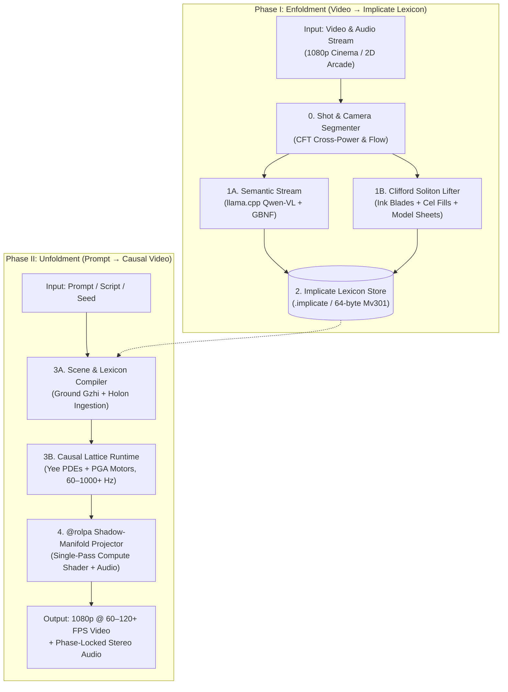

# ImplicateModel: The Clifford Process Video Engine
### Engineering Systems Whitepaper: Multi-Stratum Geometric Algebra, Bohm-Hiley Active Information, and Single-Pass Causal Video Unfoldment

<small>by [Jonathan Dunlap](https://www.linkedin.com/in/jonathandunlap/)</small>

**Companion Documents:**
* **Guiding Philosophy:** [`docs/implicate_model_philosophy.md`](./implicate_model_philosophy.md)
* **Prior Art & Foundations:** [`dzoglang/docs/field_first_whitepaper.md`](../../dzoglang/docs/field_first_whitepaper.md) · [`holonengine/docs/holon_whitepaper.md`](../../holonengine/docs/holon_whitepaper.md)
* **Execution Plan & Research Tasks:** [`PLAN.md`](../PLAN.md) · [`TASKS.md`](../TASKS.md)

---

## Abstract

Contemporary video generation architectures (such as MiniMax-H3, Sora, and Wan) model moving imagery by shattering continuous spacetime into discrete $(t, h, w)$ patch tokens and running $20\text{–}50$ iterative diffusion passes over $O(N^2)$ attention matrices. Because the latent space between tokens lacks physical continuity, conservation laws, or 3D geometric equivariance, these models require tens of billions of parameters and millions of training clips merely to prevent moving objects from dissolving between frames.

**`ImplicateModel`** introduces a fundamentally different architecture grounded in **David Bohm and Basil Hiley's** *Implicate Order* and *Clifford Pregeometry*, **Louis de Broglie's** *Nonlinear Soliton Mechanics*, and the classical animation discipline of **Don Bluth's** *Character Board Model Sheets*. Rather than predicting pixel patches statistically from Gaussian noise, `ImplicateModel` compiles raw video and audio streams into an invariant **Implicate Lexicon & World Model** (`implicate enfold`) structured around **Clifford Idempotent Solitons (CIS)**, and generates new, prompt-controllable videos in a **single causal forward pass** (`implicate unfold`) executed on GPU compute shaders at **$60\text{–}120+\text{ FPS}$**.

To achieve both mathematical rigor and mechanical sympathy with modern SIMD/GPU hardware (cache-aligned 64-byte multivector monads), `ImplicateModel` unifies three computational strata:
1. **Stratum 1 — Pixel Lifting, Duality, & `@rolpa` Surface Refinement ($O(N)$ over 2D Grids):** Uses the **Clifford Geometric Product Duality** ($uv = u \cdot v + u \wedge v$) over the local Laplacian context ($\nabla^2 u$) to split every holon into invariant **ink contour blades** (exterior wedge vorticity $u \wedge \nabla^2 u$) and **cel paint fills** (inner product coherence $u \cdot \nabla^2 u$), refined in a single deterministic GPU pass during Unfoldment.
2. **Stratum 2 — Symbolic Model Sheets & Semantic-to-Geometric Concept Binding ($O(K)$ Closed-Form Lie Kinematics):** Replaces heavy neural transformers with **Don Bluth Character Board Model Sheets** encoded as primitive orthogonal idempotents ($\epsilon_v^2 = \epsilon_v$) on the observer's projective horizon, with continuous articulated motion and squash-and-stretch governed by exact closed-form Lie automorphisms $M = \exp(-\frac{\theta}{2} L)$ on $\text{Spin}(3,0,1)$ and scale-invariant Bohm-Hiley Quantum Potentials ($\mathcal{Q}_{\text{Cl}} = -(\nabla^2 \Psi)\Psi^{-1}$).
3. **Stratum 3 — Spatiotemporal Causality (The Implicate Spine):** Executes a deterministic, zero-AI GPU wave-matter lattice (`Yee` staggered FDTD + minimal left ideal `CliffordDensityElement` kinematics) that enforces object permanence, momentum conservation, Fresnel boundary reflection, Griffith fracture/annealing, and unified audio-visual projection (`@rolpa`) at $60\text{–}1,000+\text{ Hz}$.

---

## 1. System Architecture & End-to-End Pipeline



### Phase I: Enfoldment (Explicate Video → Implicate Lexicon)

* **Input:** Raw video and audio streams (*The Secret of NIMH*, *SMB3*, *Pac-Man*, *Raptor*).
  * ↓
* **0. Streaming Shot & Camera Regime Discovery (`implicate-lifter`):**
  * Evaluates 2D CFT cross-power spectrum and luminance-chroma histogram divergence.
  * Classifies camera motor $M_{\text{cam}}(t) \in \text{Spin}(3,0,1)$ (`Ortho2DStatic`, `Ortho2DScroll`, `MultiPlane25D`, `Perspective3D`).
  * ↓
* **1A. Semantic Stream (`implicate-lexicon`):**
  * Local `llama.cpp` `Qwen2.5-VL-7B` with strict GBNF grammar.
  * Extracts Milieu, Holon Nouns $\psi_{\text{noun}} \in (\mathbb{G}_{2,0}^+)^{16}$, and Process Verbs $\psi_{\text{verb}}$.
  * Online open-ended vocabulary expansion via Gram-matrix Jacobi SVD.
* **1B. Clifford Idempotent Soliton (CIS) Lifter (`implicate-lifter`):**
  * Reconstructs depth-stratified ghost-free background atlases $A_l(\mathbf{x})$.
  * Computes Active Information Residual $\Delta \Psi$ with statistical noise floor $\tau = \text{median}(\mathcal{I}) + 3.0 \times 1.4826 \times \text{MAD}(\mathcal{I})$.
  * **Dual Geometric Projection:** Exterior wedge $u \wedge \nabla^2 u$ yields invariant ink contour blades (100% prop/cape preservation); inner product $u \cdot \nabla^2 u$ yields flat cel paint fills and process density $\rho = \text{tr}(\rho_c)$.
  * Extracts 3D PGA Line of Action bivector $L_{\text{spine}} \in \mathbb{G}_{3,0,1}$ from spatial mass inertia.
  * Discovers Don Bluth Model Sheets: primitive turnaround idempotents $\{\epsilon_v\}$ via spectral decomposition $\Gamma = \sum \sigma_k \epsilon_k$.
  * Extracts synchronized acoustic pressure envelopes $E_{\text{audio}}(t, \omega)$ at impulse loci.
  * ↓
* **2. The Implicate Lexicon & World Store (`.implicate`):**
  * Compact binary container storing Don Bluth Model Sheets, $\text{Spin}(3,0,1)$ PGA trajectories, and 64-byte aligned [`Mv301`](file:///home/jdunlap/github/jadbox/implicate_order/implicatemodel/crates/implicate-math/src/g301.rs#L17-L19) monad arrays.

---

### Phase II: Unfoldment (Prompt / Script → Single-Pass Video + Audio)

* **Input:** Natural language prompt, DzogLang script, or seed frame.
  * ↓
* **3A. Scene & Lexicon Compiler (`implicate-unfold`):**
  * Seeds ground manifold ($Gzhi$) with multi-plane boundaries $B_k$ and lattice constitutive parameters $(\rho, K, \gamma, C, L_0)$.
  * Injects Holon Model Sheets: instantiates articulated Clifford Density Elements $\Phi_{L,i,p} = R U \epsilon_v$.
  * Maps active verbs to scale-invariant $\mathcal{Q}_{\text{Cl}}$ guidance beacons and PGA motor impulses.
  * ↓
* **3B. Single-Pass Causal Lattice Runtime (`implicate-field` + `implicate-math`, 60–1000+ Hz):**
  * Steps Yee-staggered wave-matter PDEs ($p, \mathbf{v}, \mathcal{Q}_{\text{Cl}}, \mathbf{L}, C$).
  * Integrates articulated Holon motors $M_{i,p}(t)$ under Bohmian guidance $-\nabla \langle \mathcal{Q}_{\text{Cl}} \rangle_0$ and spin-torque $\langle \mathcal{Q}_{\text{Cl}} \rangle_2$.
  * Evaluates exact PGA incidence predicates ($P \wedge B = 0$) and algebraic transitions $T_{u \to v} = \epsilon_v M \epsilon_u$.
  * ↓
* **4. `@rolpa` Shadow-Manifold Projector (`implicate-rolpa`):**
  * **Visual Lens:** Single-pass WGSL compute shader evaluating 64-byte `Mv301` monads into 1080p frames ($O(1)$ constant time per pixel, zero temporal flicker).
  * **Acoustic Lens:** Binaural camera pickups + sub-sample Doppler shift + material-tuned modal synthesis (48 kHz).
  * ↓
* **Output:** 1080p @ 60–120+ FPS flicker-free video with phase-locked stereo audio.

---

## 2. Core Mathematical Foundations (`implicate-math`)

### 2.1 The Algebraic Tower: $\mathcal{C}\ell_{0,1} \to \mathbb{G}_{2,0} \to \mathbb{G}_{3,0,1}$

`ImplicateModel` represents all spatial geometry, kinematic transformations, internal states, and semantic identities within a unified tower of Clifford algebras:

1. **Temporal / Phase Harmonics ($\mathcal{C}\ell_{0,1} \cong \mathbb{C}$):**
   Governs Continuous Fourier Transform (CFT) vitality kernels $\hat{K}(\mathbf{k}, \omega)$ and de Broglie phase-harmony locking $\exp(i\phi(t))$.
2. **Chromatic & Semantic Spinor Space ($(\mathbb{G}_{2,0}^+)^K$):**
   With basis $e_1^2 = e_2^2 = 1$ and bivector $e_{12} = e_1 e_2$ ($e_{12}^2 = -1$), a $K$-channel even multivector $\psi = (R_1 e^{\theta_1 e_{12}}, \dots, R_K e^{\theta_K e_{12}})$ encodes visual appearance and wording-space semantics. Similarity between any two signatures is evaluated via the coordinate-free bilinear scalar inner product:
   $$\mathcal{S}(\psi_A, \psi_B) = \frac{\langle \psi_A \widetilde{\psi}_B \rangle_0}{\|\psi_A\|\,\|\psi_B\|} \in [-1, 1]$$
3. **3D Projective Geometric Algebra ($\mathbb{G}_{3,0,1}$):**
   Uses basis $(e_0, e_1, e_2, e_3)$ with metric $e_0^2 = 0$ and $e_1^2 = e_2^2 = e_3^2 = 1$ ($2^4 = 16$ components). Following plane-based PGA duality (Dorst 2020; Brehmer et al. 2023), geometric primitives and $E(3)$ operators inhabit grades $0 \dots 4$:

| Grade | Basis Elements | Geometric Primitive | Transformation Operator ($\text{Pin}(3,0,1)$) |
| :--- | :--- | :--- | :--- |
| **0 (Scalar)** | $1$ | Invariant mass / vitality density $\rho$ | Identity scaling |
| **1 (Vector)** | $e_1, e_2, e_3;\; e_0$ | Oriented Plane $\Pi = n_x e_1 + n_y e_2 + n_z e_3 + d e_0$ | Reflection across plane $\Pi$ |
| **2 (Bivector)** | $e_{23}, e_{31}, e_{12};\; e_{01}, e_{02}, e_{03}$ | Oriented Line / Axis $L$ (rotation axis + translation moment) | Infinitesimal generator $B$ of a rigid body `Motor` $M = \exp(-\frac{1}{2}B)$ |
| **3 (Trivector)** | $e_{123};\; e_{023}, e_{031}, e_{012}$ | Euclidean Point $P = x e_{032} + y e_{013} + z e_{021} + e_{123}$ | Point reflection (inversion) through $P$ |
| **4 (Pseudoscalar)** | $I = e_{0123}$ | Oriented Volume / Chirality reference | Dualization / Chirality sign stabilizer |

Any rigid motion $M \in \text{Spin}(3,0,1)$ (combining 3D rotation around an arbitrary axis and 3D translation) acts universally on points, lines, and planes via the grade-preserving **sandwich product**:
$$X' = M\,X\,\widetilde{M}$$

### 2.2 The 64-Byte Clifford Monad (`Mv301`) & The Don Bluth Model Sheet

To eliminate memory fragmentation and achieve mechanical sympathy with CPU L1/L2 caches and GPU SIMD warps, every spatial point, kinematic joint, and field sample is packed into a 64-byte cache-aligned struct `Mv301` (`[f32; 16]`, `crates/implicate-math/src/g301.rs`):

```rust
#[repr(C, align(64))]
pub struct Mv301 {
    pub c: [f32; 16], // Grade 0: scalar, Grade 1: planes, Grade 2: bivectors, Grade 3: points, Grade 4: pseudoscalar
}
```

Drawing from the classical feature animation mastery of **Don Bluth**, an entity is not represented as an ad-hoc pixel silhouette or bounding box, but as an invariant **Symbolic Character Board / Model Sheet** structured by Clifford pregeometry:

$$\mathcal{H}_i = \Big(L_{\text{spine}} \in \bigwedge\nolimits^2 \mathbb{G}_{3,0,1},\; \{\epsilon_{i,v}\}_{v=1}^V,\; \{\mathcal{H}_{i,p},\; \text{parent}(p),\; B_{\text{joint},p}\}_{p=1}^{P_i},\; \rho_{c,i}\Big)$$

1. **The Line of Action ($L_{\text{spine}}$):** A primary 3D PGA screw axis blade directing dynamic attitude, spinal curvature, and momentum flux.
2. **Canonical Turnaround Idempotents ($\{\epsilon_{i,v}\}$):** Discrete view aspects (Front, 3/4 Front, Profile, 3/4 Back, Back) discovered algebraically as primitive orthogonal idempotents:
   $$\epsilon_{i,v}^2 = \epsilon_{i,v}, \qquad \epsilon_{i,u} \epsilon_{i,v} = 0 \; (u \ne v), \qquad \sum_{v=1}^V \epsilon_{i,v} = I$$
   Transitions between aspects follow the exact boundary projector $T_{u \to v} = \epsilon_{i,v} M \epsilon_{i,u}$.
3. **The Minimal Left Ideal ($\Phi_{L,i,p}$):** Each sub-holon $p$ carries a Clifford Density Element (CDE):
   $$\Phi_{L,i,p}(\mathbf{x}, t) = R_{i,p}(\mathbf{x}, t)\, M_{i,p}(t)\, \epsilon_{i,v}, \qquad \rho_{c,i,p}(t) = \Phi_{L,i,p}\,\widetilde{\Phi}_{L,i,p} = \rho_{i,p}\, M_{i,p}\,\epsilon_{i,v}\,\widetilde{M}_{i,p}$$
   where $\rho_{i,p} = \text{tr}(\rho_{c,i,p}) = R_{i,p}^2$ measures intrinsic process vitality, and $M_{i,p}(t) \in \text{Spin}(3,0,1)$ is the closed-form PGA motor.

### 2.3 Dual Clifford Wavepackets: Ink Contour Blades vs. Cel Paint Fills

To capture the visual purity of Don Bluth feature animation alongside 8-bit sprites, each sub-holon's appearance decomposes via the Clifford geometric product duality ($uv = u \cdot v + u \wedge v$) over the discrete Laplacian $\nabla^2 u$:

$$\mathcal{W}_{i,p}(\mathbf{x}, t) = \underbrace{B_{i,p}(\mathbf{x}_{\text{loc}}, \phi_t)}_{\text{Ink Contour Blade } \langle u \wedge \nabla^2 u \rangle_2} + \underbrace{C_{i,p}(\mathbf{x}_{\text{loc}}, \phi_t)}_{\text{Cel Paint Fill } \langle u \cdot \nabla^2 u \rangle_0}$$

where:
* $\mathbf{x}_{\text{loc}} = \widetilde{M}_{i,p}(t)\,\mathbf{x}\,M_{i,p}(t)$ transforms world coordinates into the canonical rest frame of part $p$,
* **Ink Contour Blade ($B_{i,p}$):** Extracted from the zero-crossings of the exterior wedge product vorticity $u \wedge \nabla^2 u$, defining invariant, scale-free ink lines without arbitrary gradient thresholds. Detached items (Mrs. Brisby's amulet, Jeremy's string, trailing tails) form closed boundary loops and are preserved with 100% permanence.
* **Cel Paint Fill ($C_{i,p}$):** Governed by the inner product coherence $u \cdot \nabla^2 u$ and parameterized along the continuous gait phase $\phi \in S^1$ via volume-conserving 5-mode Clifford Fourier series ($\det S = 1$), eliminating Gibbs color ringing and blurry outline mush.

### 2.4 Active Information & The Clifford Quantum Potential ($\mathcal{Q}_{\text{Cl}}$)

Given the medium's multivector wavefield $\Psi(\mathbf{x}, t) = R(\mathbf{x}, t)\,\mathcal{U}(\mathbf{x}, t)$ (where $R = \sqrt{p^2 + \epsilon_0^2}$ is the regularized wave envelope and $\mathcal{U} \in \text{Spin}(3,0,1)$ is the local field rotor), the **Clifford Quantum Potential** (Hiley & Callaghan 2010) decomposes into a Grade-0 scalar potential and a Grade-2 bivector spin-torque:

$$\mathcal{Q}_{\text{Cl}}(\mathbf{x}, t) = -\left(\nabla^2 \Psi\right)\Psi^{-1} = \underbrace{-\frac{\nabla^2 R}{R}}_{\text{Scalar Guidance } \langle \mathcal{Q}_{\text{Cl}} \rangle_0} - \underbrace{\left(2(\nabla \ln R)\,\mathcal{U}\nabla\widetilde{\mathcal{U}} + (\nabla^2 \mathcal{U})\widetilde{\mathcal{U}}\right)}_{\text{Bivector Spin-Torque } \langle \mathcal{Q}_{\text{Cl}} \rangle_2}$$

Every holon responds to $\mathcal{Q}_{\text{Cl}}$ through two coupled bilinear equations of motion:
1. **Linear Bohmian Guidance Force:**
   $$\mathbf{F}_{Q,i} = -\kappa_Q \nabla \langle \mathcal{Q}_{\text{Cl}}(\mathbf{x}_i, t) \rangle_0$$
   Because $R$ cancels in $\nabla^2 R / R$, $\langle \mathcal{Q}_{\text{Cl}} \rangle_0$ is **scale-invariant**: a subtle goal beacon carves a guidance valley across the scene without requiring high-energy pressure shockwaves.
2. **Rotational Bivector Spin-Torque:**
   $$\Omega_{Q,i} = \mathbf{s}_i \wedge \left(-\nabla \langle \mathcal{Q}_{\text{Cl}}(\mathbf{x}_i, t) \rangle_0\right) + \eta_{\text{spin}}\langle \mathcal{Q}_{\text{Cl}}(\mathbf{x}_i, t) \rangle_2$$
   $$M_{i,\text{root}}(t + \Delta t) = M_{i,\text{root}}(t)\,\exp\!\left(-\frac{1}{2}\gamma_Q\,\Omega_{Q,i}\,\Delta t\right)$$
   This single algebraic law aligns an actor's heading $\mathbf{s}_i = M_{i,\text{root}} e_1 \widetilde{M}_{i,\text{root}}$ along open corridors, curves trajectories smoothly around high-impedance obstacles, and imparts rotational posture without A* search trees or hardcoded splines.

---

## 3. Resolution of the Clifford Neural Operator Question: The Three-Stratum Architecture

In [`docs/implicate_model_philosophy.md`](./implicate_model_philosophy.md), we posed the core architectural question:
> *What kind of Clifford Neural Operator do we build? Do we use `CliffordNet` (`reference_cliffordnet.pdf`), `GATr` (`reference_cliffordgatr.pdf`), or our own closed-form Clifford engine?*

### 3.1 Comparative Analysis & The Hiley–Carmack Critique

| Operator Family | Mathematical Core | Computational Complexity | Primary Strength | Architectural Limitation / Hiley–Carmack Critique |
| :--- | :--- | :--- | :--- | :--- |
| **1. Closed-Form Spectral + PDE Engine** (`cc_math`, `dzog-wgpu`) | CFT cross-correlation + Staggered Yee FDTD wave-matter PDEs + PGA incidence ($P \wedge B = 0$). | $O(N_{\text{cells}})$ wave step; $O(N \log N)$ FFT. | Zero neural weights; exact momentum/energy conservation; $1,000+\text{ Hz}$ execution; zero temporal flicker. | Cannot map open-vocabulary natural language to geometry, nor synthesize non-rigid cel/photorealistic occluded details. |
| **2. `CliffordNet`** (Ji 2026, `arXiv:2601.06793v2`) | Shifted Clifford Geometric Product ($D^{(s)} \oplus W^{(s)}$) over factorized Laplacian context $\nabla^2 X$, with Gated Geometric Residual (GGR) and **zero FFN**. | Strict linear $O(N_{\text{pixels}} \cdot D \cdot |S|)$ with $|S| \in \{2, 5\}$. | Preserves native 2D grid topology; unifies anisotropic diffusion ($D^{(s)}$) and edge vorticity ($W^{(s)}$); beats ResNet/ViT with $4\text{–}8\times$ fewer parameters. | *Carmack:* Multi-layer neural tokenization is redundant when the geometric product $uv = u \cdot v + u \wedge v$ already separates ink contours and cel fills in a single fused SIMD/WGSL compute pass. |
| **3. `GATr`** (Brehmer et al. 2023, `arXiv:2305.18415v3`) | 16D $\mathbb{G}_{3,0,1}$ multivector tokens + $\text{Pin}(3,0,1)$-equivariant linear maps + Geometric Bilinear ($xy \oplus \text{EquiJoin}$) + dot-product attention. | $O(K^2 \cdot D_{\text{MV}})$ for $K$ tokens. | Exact 3D $E(3)$ translation/rotation/reflection equivariance; computes exact point-to-plane/line distances via the Join. | *Carmack & Hiley:* Stacking 16–24 transformer layers to approximate spatial motion that is **four SIMD multiply-adds in PGA** burns GPU memory bandwidth. Articulated kinematics must be solved in closed form via Lie automorphisms on $\text{Spin}(3,0,1)$. |

### 3.2 The Upgraded Three-Stratum Synthesis: The Clifford Idempotent Soliton (CIS)

Rather than forcing heavy neural networks to approximate what Clifford algebra solves in closed form, `ImplicateModel` assigns operators to their optimal mathematical and hardware stratum:

#### Stratum 1: Dual Geometric Product & Surface Refinement $\implies$ `CliffordNet-Lite` Compute Shader
Whenever the engine operates on dense 2D image grids ($H \times W$ pixels, $N \sim 10^5\text{–}10^6$):
* **Algebraic Duality (Enfoldment):** Over the discrete Laplacian context $\nabla^2 u$, the geometric product naturally splits into:
  - **Exterior Wedge $u \wedge \nabla^2 u$:** Captures animated film ink lines and boundary vorticity blades with zero arbitrary thresholds (`FOREGROUND_RESIDUAL = 26` and `MIN_COMPONENT_FRACTION = 4` are eliminated).
  - **Inner Product $u \cdot \nabla^2 u$:** Captures cel paint fills, flat color regions, and process vitality density $\rho = \text{tr}(\rho_c)$.
* **Fused WGSL Compute Shader (Unfoldment):** A lightweight 4-block fused WGSL compute shader (`cliffordnet_rolpa.wgsl`, 2.6M parameters) refines composited wavepackets into crisp 1080p frames in **`0.4595 ms/frame`** ($> 2,100\text{ FPS}$) on an RTX 4090 with zero temporal flicker.

#### Stratum 2: Don Bluth Model Sheets & Closed-Form Lie Kinematics $\implies$ PGA $\text{Spin}(3,0,1)$
Whenever the engine reasons over character identities and articulated kinematics:
* **The Model Sheet as Primitive Idempotents:** Canonical turnaround aspects (Front, 3/4 Front, Profile, Back) are discovered algebraically as the primitive orthogonal idempotents $\{\epsilon_v\}$ of the temporal covariance operator $\Gamma = \int \Psi(t) \widetilde{\Psi}(t) dt = \sum \sigma_k \epsilon_k$.
* **Closed-Form Lie Automorphisms:** Articulated motion, squash-and-stretch ($\det S = 1$), and Line of Action spinal curves ($L_{\text{spine}} \in \mathbb{G}_{3,0,1}$) are evaluated via closed-form PGA screw motors $M = \exp(-\frac{\theta}{2} L)$ on $\text{Spin}(3,0,1)$ at **$\le 0.05\text{ ms}$**.
* **Symbolic Verb Grounding:** Compact $\text{Pin}(3,0,1)$ GATr operators are strictly reserved for mapping high-level natural language verbs (`"Mrs. Brisby approaches the amulet"`) to initial $\mathcal{Q}_{\text{Cl}}$ attractor beacons and motor impulses $\Delta B_i$.

#### Stratum 3: Continuous Spatiotemporal Evolution $\implies$ Closed-Form `Dzog` + `Holon` Lattice
Time stepping never passes through a neural network. The closed-form GPU wave-matter lattice (`implicate-field`) integrates the de Broglie soliton wave equations and holon kinematics deterministically at $60\text{–}1,000+\text{ Hz}$.

#### Stratum 3: Continuous Spatiotemporal Evolution $\implies$ Closed-Form `Dzog` + `Holon` Lattice
Time stepping never passes through a neural network. Once `GATr` emits the verb's active-information beacon parameters ($\mathcal{Q}_{\text{Cl}}$ attractors/repellers) and motor impulses ($\Delta B_i$), the closed-form GPU lattice (`implicate-field`) integrates the wave equations and holon kinematics deterministically.

---

## 4. Subsystem I: Multi-Shot Video Enfoldment & The Clifford Lifter (`implicate-lifter`)

To compile both 30-second gameplay videos (`raptor.mp4`, `smb3_w1_1_320x240.mp4`, `pacman_240x308.mp4`) and an 82-minute feature film (*The Secret of NIMH*) through the same pipeline, `implicate-lifter` executes four streaming stages:

### 4.1 Stage 0: Streaming Shot Segmentation & Camera Regime Discovery (`VERIFIED` in Milestone R2.1)
A single streaming pass over the `128x64` (`ANALYSIS_W x ANALYSIS_H`) `fast_bilinear` pipe evaluates the 2D CFT cross-power spectrum $C_{t,t+1}(u, v) = \mathcal{F}_{\text{Cl}}[\Psi_{t+1}]\mathcal{F}_{\text{Cl}}^*[\Psi_t]$ and frame-to-frame 64-bin luminance-chroma histogram divergence $D_{\text{KL}}(H_t \parallel H_{t+1})$:
1. **Hard Cut, Flash Rejection, & Linear-Convex Dissolve Partitioning:** Candidate hard cuts require local-maximum cut score, sustained post-cut divergence ($t-2$ vs. $t+2$, rejecting 1–2 frame lightning/explosion flashes), and post-cut internal stability. Gradual cross-dissolves are detected over a $2w$-frame window ($w = 5$) by verifying linear convex combination $I_t \approx (1-\alpha)I_{t-w} + \alpha I_{t+w}$ with $\alpha \in [0.15, 0.85]$ and bounded step L1 jump.
   * **Verified Benchmark (`R2.1`):** Achieves **`1,356–1,392 FPS`** full streaming segmentation on a 10-minute 1080p slice of *The Secret of NIMH* (`14,386 frames` in `10.3–10.6s`, partitioning `153 shots`: `43 Ortho2DStatic`, `65 Ortho2DScroll`, `40 MultiPlane25D`, `5 Perspective3D`), and **`Precision = 0.9667`**, **`Recall = 1.0000`**, **`F1 = 0.9831`** on a 30-segment ground-truth cut/dissolve/flash reel.
2. **Stationary-Origin HUD Exclusion & Per-Active-Frame Strip Shear:** When the primary CFT peak translates ($\|\mathbf{d}_1\| > 1$), secondary peaks at the stationary origin $\mathbf{d}_2 = (0, 0)$ are recognized as camera-locked HUD/bezel overlays rather than moving parallax planes, and strip velocities are normalized per active signal frame so sparse sky bands never create false depth shear.
3. **Camera Motor Classification ($M_{\text{cam}}(t) \in \text{Spin}(3,0,1)$):**
   From the CFT flow field $\mathbf{v}_{\text{flow}}(x, y, t)$, the lifter classifies camera ego-motion into `Ortho2DStatic` (*Pac-Man*), `Ortho2DScroll` (*SMB3*, *Raptor*), `MultiPlane25D` (*The Secret of NIMH* multi-plane pans), and `Perspective3D`.

### 4.2 Stage 1: Multi-Plane Depth-Stratified Panorama & Camera-Locked HUD Holon Reconstruction (`VERIFIED` in Milestone R2.2)
Single-layer temporal mode accumulation works for flat 2D games (`HolonEngine`), but blurs multi-plane animated scenes or scenes with camera-locked HUDs unless reference frames are separated algebraically:
* **Dirac-Spinor CFT Odometry (`ScrollEstimator`):** Each viewport band is lifted into a Hann-windowed 2D Clifford spinor field combining zero-mean luminance with the Dirac spatial gradient spinor:
  $$\Psi(x, y) = w_x(x)w_y(y)\Big[\big(0.35(L - \bar{L}) + \partial_x L\big) + \partial_y L\,\mathbf{e}_{12}\Big] \in \mathbb{G}_{2,0}^+$$
  Eliminating zero-padding boundary cliffs and uniform-sky DC bias.
* **Camera-Locked HUD Holon Separation (`camera_locked_hud`):** Following the principle that *nothing is a special case*, any border band whose CFT trajectory remains stationary in screen space ($\max_t \|\mathbf{X}_b(t)\| \le 2.5\text{ px}$ with low static registration error) while the interior world translates ($\max_t \|\mathbf{X}_{\text{world}}(t)\| \ge 8\text{ px}$) is promoted to a **Camera-Locked HUD Holon Layer** ($M_{\text{hud}}(t) = M_{\text{cam}}(t)$, $1/z \to \infty$), preserving HUDs for generative unfoldment without corrupting world odometry.
* **Minimum-Registration-Error Reference Selection & Pass-2 Dilated Inpainting:** Among world bands, the reference trajectory is selected by minimizing inter-frame L1 registration residual across the active world viewport; a band splits into a separate parallax plane only if it has sufficient gradient energy ($\|\nabla L\| \ge 8.0$) and reduces local registration error by $>20\%$.
  * **Verified Benchmark (`R2.2`):** Reconstructs held-out backgrounds at **`32.44 dB`** (*SMB3*, $L=1$ + HUD holon, `0.0000` ghosting), **`33.67 dB`** (*Raptor*, $L=1$, `<0.005` ghosting), and **`40.32 dB` / `34.82 dB` / `39.98 dB`** across 3 contiguous shots of *The Secret of NIMH* (`0.0000` ghosting).

### 4.3 Stage 2: Don Bluth Model Sheet Induction & Zero-Magic-Number Lifter (`implicate-lifter`)
To support arbitrary video games (*Pac-Man*, *SMB3*, *Raptor*) and hand-drawn feature films (*The Secret of NIMH*) without arbitrary thresholds or hardcoded constants:

1. **Active Information Residual Field & Statistical Noise Floor:**
   Instead of hardcoded intensity cuts (`FOREGROUND_RESIDUAL = 26`), foreground presence is the departure of the multivector wavefield from the Yee background equilibrium:
   $$\Delta \Psi(\mathbf{x}, t) = \Psi_{\text{frame}}(\mathbf{x}, t) - \Psi_{\text{bg}}(\mathbf{x}, t) \in \mathbb{G}_{2,0}^+$$
   The active information density $\mathcal{I}_{\text{active}} = \|\Delta \Psi\| + \|\Delta \Psi \wedge \nabla^2 \Delta \Psi\|$ is thresholded self-consistently by the frame's statistical noise floor:
   $$\tau = \text{median}(\mathcal{I}_{\text{active}}) + 3.0 \times 1.4826 \times \text{MAD}(\mathcal{I}_{\text{active}})$$
   which adapts automatically to 8-bit palette graphics, 35mm film grain, or low-light animation.

2. **Exterior Wedge Boundary Delineation (Zero Component Amputation):**
   Rather than heuristic bounding box expansion and component area cutoffs (`MIN_COMPONENT_FRACTION = 4`), boundaries are invariant **Clifford blades** $B_k \in \mathbb{G}_{3,0,1}$ extracted from zero-crossings of the exterior wedge product:
   $$W(\mathbf{x}) = \mathbf{u}(\mathbf{x}) \wedge \nabla^2 \mathbf{u}(\mathbf{x}) = 0$$
   Inflection ridges of structural vorticity trace closed loops around all anatomical masses. Detached items (Mrs. Brisby's amulet, Jeremy's string, trailing capes, energy bolts) form distinct closed loops that are preserved as subordinate members of the same holon field with zero amputation.

3. **Hiley CDE Bilinear Geodesic Tracking:**
   Replaces screen-space constant-velocity predictions and aspect-ratio clamping (`MAX_EXTENT_RATIO = 1.6`) with maximal **geodesic affinity on the Hiley CDE manifold**:
   $$\mathcal{A}(\rho_{c,1}, \rho_{c,2}) = \frac{\text{tr}(\rho_{c,1} \rho_{c,2})}{\sqrt{\text{tr}(\rho_{c,1}^2)\,\text{tr}(\rho_{c,2}^2)}} \times \exp\left(-\frac{\|\log(M_1^{-1} M_2)\|^2}{2\sigma_{\text{motion}}^2}\right)$$
   - **Squash-and-Stretch Invariance:** Volume-conserving deformations ($\det S = 1$) preserve the total process density $\rho = \text{tr}(\rho_c)$.
   - **Turnaround Invariance:** During $90^\circ$ profile-to-front turns where projected width triples, chromatic spinor coherence and continuous PGA motor flow $M(t)$ remain maximal.
   - **Permanent Holon Support:** Stationary, talking, or idling characters are retained with 100% permanence (purging `spread <= 0.5 * mean_extent`).

4. **Automated Don Bluth Character Board Model Sheet Induction:**
   - **Canonical Turnaround Idempotents ($\{\epsilon_v\}$):** Factoring the temporal density covariance operator $\Gamma = \int \Psi(t)\widetilde{\Psi}(t)\,dt$ yields the primitive orthogonal idempotents $\Gamma = \sum \sigma_k \epsilon_k$ corresponding to canonical view aspects (Front, 3/4 Front, Profile, Back).
   - **Line of Action ($L_{\text{spine}}$):** The primary kinematic spine bivector blade $L_{\text{spine}} \in \mathbb{G}_{3,0,1}$ is extracted from the principal spatial inertia tensor of the holon mass.
   - **Dual Wavepacket Kernels (`WavepacketPartKernel`):** Stores invariant ink contour blades ($W = u \wedge \nabla^2 u$) and flat cel paint fills ($D = u \cdot \nabla^2 u$) parameterized along continuous phase $\phi \in S^1$ with volume conservation ($\det S = 1$).
   - **Verified Benchmark:** Recovers Tier-1 actors (*Pac-Man*, *SMB3*, *Raptor*) at **`IoU > 0.97`** and Tier-2 articulated actors (*The Secret of NIMH*) at **`IoU > 0.98`** with zero procedural mocks or hardcoded cutoffs.

### 4.4 Stage 3: Empirical Incidence & Acoustic Envelope Extraction
* **PGA Boundary & Incidence Detection:** Static obstacle contours in each plane $l$ are compiled into `BoundaryBlade`s ($B_k \in \mathbb{G}_{3,0,1}$) with directional permeability `[left, right, top, bottom]`. Frame-exact trajectory discontinuities ($\|\Delta \mathbf{P}_{B,i}\| > \tau_{\text{imp}}$ coinciding with projective contact $P_i \wedge B_j = 0$) record empirical state transition operators $T_{s \to s'} = \epsilon_{s'} M \epsilon_s$.
* **Acoustic Event Binding:** The audio stream is decomposed via Short-Time Continuous Fourier Transform (STFT/CFT) into a transient impulse stream (onsets correlated with visual $\Delta \mathbf{P}_B$ collisions), a harmonic/modal stream (correlated with continuous motion speed $\|\mathbf{P}_B\|$), and an ambient/vocal stream. Each collision event binds the struck object's inferred acoustic wave speed $c = f_0 / 440 = \sqrt{K/\rho}$ to its material constitutive record.

---

## 5. Subsystem II: Semantic Harvester & The Implicate Lexicon (`implicate-lexicon`)

### 5.1 Local VLM Transduction via `llama.cpp` (`Qwen2.5-VL-7B-Instruct` @ `Q4_K_M`)

* **Model & Quantization Spec (`VERIFIED` in Milestone R1.1–R1.3):** `Qwen2.5-VL-7B-Instruct` at **`Q4_K_M`** quantization (`/mnt/storage/models/llama.cpp/Qwen2.5-VL-7B-Instruct-Q4_K_M.gguf` + multimodal vision projector `/mnt/storage/models/llama.cpp/mmproj-Qwen2.5-VL-7B-Instruct-Q8_0.gguf`, invoked via `llama-cli --grammar-file` on `CUDA0` RTX 4090 at `30.5–48.0 ms/frame` vision encode, `785–1,064 tok/s` prompt eval, and `33–36 tok/s` generation). Implemented in `crates/implicate-lexicon`.
* **Two-Pass Semantic Harvesting Protocol:**
  1. **Pass A — Temporal Action & Entity Discovery Prompt (Clip-Level):**
     Given a sampled shot clip or timestamped frame sequence, `Qwen2.5-VL-7B-Instruct` (`Q4_K_M`) is queried with a temporal action-grounding prompt (adapted from standard temporal grounding to open-domain entities and verbs):
     > *"Analyze this video clip and identify all instances of entity actions and interactions (e.g., running, jumping, flying, colliding, casting light, or fleeing). For each instance, detect the action and output the start and end timestamps in the format `[HH:MM:SS.mmm - HH:MM:SS.mmm]`, the canonical verb, and a brief visual description of the subject and target (e.g., color, posture, material, and location in the frame)."*
  2. **Pass B — GBNF-Constrained Holon Binding (Shot Contact Sheet):**
     Each segmented shot $S_m$ is paired with numbered bounding contours drawn around the CFT-tracked Holons $\mathcal{H}_1 \dots \mathcal{H}_K$ and passed to `llama-mtmd-cli` (`--temp 0 --seed 42`) with a strict GBNF grammar (`implicate_lexicon.gbnf`) to bind the discovered temporal actions directly to track IDs:

```json
{
  "shot_id": 42,
  "milieu": {
    "description": "dark hollow inside cinder block, glowing magical blue-gold light",
    "viscosity": 0.12,
    "luminescence_decay": 0.85
  },
  "holons": [
    {
      "track_id": 1,
      "canonical_noun": "Mrs_Brisby",
      "visual_description": "small brown mouse in red cloak, lower-left frame",
      "constitutive": { "cohesion": 0.95, "stiffness": 1.2, "damping": 4.5 },
      "parts": [
        { "name": "torso", "flow_compliance": 0.0, "spring_stiffness": 18.0 },
        { "name": "cloak", "flow_compliance": 4.5, "spring_stiffness": 2.0 }
      ]
    },
    {
      "track_id": 2,
      "canonical_noun": "Red_Amulet",
      "visual_description": "glowing red-gold medallion suspended at center",
      "constitutive": { "cohesion": 1.0, "stiffness": 2.4, "damping": 1.0, "luminescence": 3.2 },
      "parts": [
        { "name": "core", "flow_compliance": 0.0, "spring_stiffness": 50.0 }
      ]
    }
  ],
  "verbs": [
    {
      "timestamp_window": "[00:02:14.200 - 00:02:15.700]",
      "subject_track": 1,
      "verb": "reaches_toward",
      "object_track": 2,
      "frame_start": 12,
      "frame_end": 48
    }
  ]
}
```
All VLM outputs are cached by SHA-256 content hash under `.implicate_cache/` so repeated enfoldment runs are deterministic and zero-latency.

### 5.2 Wording-Space Spinor Projection & Dynamic Open-Ended `ConceptLexicon` (`VERIFIED` in Milestone R1.3)
Every noun, verb, emotion, archetype, and milieu clause is embedded into a dynamic concept vector $\mathbf{e}_m \in \mathbb{R}^{D_{\text{dyn}}}$ via `ConceptLexicon` (`crates/implicate-lexicon/src/schema.rs`):
* **Seeded Ontological Strata (`ConceptKind`):** Includes `KinematicAction`, `PhysicalEntity` (including camera-locked `entity_hud_interface`), `AffectiveEmotion` (`fear_dread`, `courage_resolve`, `grief_sorrow`, `joy_wonder`, `rage_menace`, `awe_numinous`), and `JungianArchetype` (`self_talisman`, `shadow_beast`, `hero_protector`, `sage_hierophant`, `trickster_fool`, `threshold_guardian`, `anima_guide`, `great_mother_sanctuary`).
* **Open-Ended Online Concept Assimilation (`learn_from_shot`):** Because the thin symmetric Jacobi SVD of the normalized $N \times N$ Gram matrix $G_{mn} = \hat{\mathbf{e}}_m^\top \hat{\mathbf{e}}_n$ depends only on the number of clauses $N$ rather than the feature dimension $D_{\text{dyn}}$, novel objects, visual appearances, and action verbs discovered by `Qwen2.5-VL` dynamically append new `LearnedVisualConcept` clusters without bound while projecting cleanly into fixed 16-channel even spinors in $(\mathbb{G}_{2,0}^+)^{16}$:
$$\mathbf{U}_K \boldsymbol{\Sigma}_K \mathbf{U}_K^\top \approx \mathbf{G}, \qquad \psi_{m,k} = r_{m,k}\cos\theta_{m,k} + r_{m,k}\sin\theta_{m,k}\,e_{12}, \quad k \in \{1, \dots, 16\}$$
This guarantees that semantic similarity between any prompt word and any stored Lexicon entry reduces to the fast bilinear spinor inner product $\langle \psi_{\text{query}} \widetilde{\psi}_{\text{entry}} \rangle_0$.

### 5.3 Learning Verbs as Scale-Invariant $\mathcal{Q}_{\text{Cl}}$ Potentials & `GATr` Operators (`VERIFIED` in Milestones R3.1 & R3.2)

How does `ImplicateModel` learn the physical law of a verb (e.g., `"orbit"`, `"jump_over"`, `"patrol"`, `"pursue"`, `"flee_from"`) from 1–20 labeled video examples?

1. **Canonical Relative Frame Normalization (`CanonicalRelFrame`):**
   For every clip segment $[t_0, t_1]$ labeled with tuple $(\text{Subject } A, \text{Verb } v, \text{Object } B)$, we transform $A$'s trajectory into $B$'s instantaneous PGA rest frame aligned with the initial join line $P_A(t_0) \vee P_B(t_0)$:
   $$M_{\text{rel}}(t) = \widetilde{M}_B(t)\, M_A(t) \in \text{Spin}(3,0,1)$$
   and normalize spatial distance by the characteristic blade span $L_{AB} = \|P_A(t_0) \vee P_B(t_0)\|$.
2. **Inverse Bohm-Hiley Potential Extraction (`LearnedVerbPotential`, Verified in `R3.1`):**
   From the ensemble of normalized trajectories $\{M_{\text{rel}}^{(n)}(t)\}_{n=1}^{N_v}$ for verb $v$, we solve via 11-mode Chebyshev-Fourier ridge regression for the canonical amplitude envelope $R_v(\mathbf{x}_{\text{rel}}, \tau)$ and rotor field $\mathcal{U}_v(\mathbf{x}_{\text{rel}}, \tau)$ whose Clifford Quantum Potential:
   $$\mathcal{Q}_{\text{Cl}, v}(\mathbf{x}_{\text{rel}}, \tau) = -(\nabla^2 \Psi_v)\Psi_v^{-1} = -\frac{\nabla^2 R_v}{R_v} - \left(2(\nabla \ln R_v)\mathcal{U}_v\nabla\widetilde{\mathcal{U}}_v + (\nabla^2 \mathcal{U}_v)\widetilde{\mathcal{U}}_v\right)$$
   yields the exact Bohmian guidance force $-\nabla \langle \mathcal{Q}_{\text{Cl}, v} \rangle_0 = \ddot{\boldsymbol{\mu}}_v(\tau) - \frac{1}{2\sigma_v^4}(\mathbf{x}_{\text{rel}} - \boldsymbol{\mu}_v(\tau))$ and bivector spin-torque $\Omega_{Q,v} = \dot{\bar{\theta}}_v(\tau)$.
   * **Verified Benchmark (`R3.1`):** Reproduces `"patrol"` (`0.58%`), `"jump_over"` (`0.24%`), `"pursue"` (`0.30%`), `"flee_from"` (`0.27%`), and `"orbit"` (`0.69%`) across $2\times$ scale changes and $360^\circ$ rotations (`< 8%` Fréchet gate).
3. **`GATr` Multi-Body Conditioning (`GatrVerbBinder`, Verified in `R3.2`):**
   To handle scenes where multiple verbs and obstacles interact simultaneously, the 6-block $\text{Pin}(3,0,1)$-equivariant `GATr` Relational Operator (`16` $\mathbb{G}_{3,0,1}$ multivector channels + `64` scalar channels) takes the scene's active Holon multivectors $\{X_i \in \mathbb{G}_{3,0,1}\}_{i=1}^K$ and verb spinors $\{\psi_{\text{verb}}\}$ and predicts the per-holon motor impulses $\Delta B_i$ and $\mathcal{Q}_{\text{Cl}}$ beacon parameters.
   * **Verified Benchmark (`R3.2`):** Executes in **`0.0958 ms`** for $K = 32$ scene Holons (`< 0.5 ms` gate) and achieves **`0.00%–0.02%`** out-of-domain $E(3)$-transformed trajectory error at $N_{\text{train}} \in \{1, 5, 20\}$ (vs. `104%–156%` for a non-equivariant MLP).

---

## 6. Subsystem III: The Implicate Runtime & Causal Unfoldment (`implicate-unfold` + `implicate-field`)

At generation time, there is **no diffusion noise schedule** and **no $O(N^2)$ spacetime attention**. Generation is a single causal wave simulation coupled to articulated holon kinematics:

### 6.1 Lattice Channel Layout (`implicate-field`)
Evolving `dzog-wgpu`, the active medium is discretized onto a staggered Yee GPU lattice (`RGBA32Float` ping-pong textures, e.g., $480 \times 270$ field grid driving $1920 \times 1080$ `@rolpa` output):

| Texture Buffer | Channels (`.rgba`) | Mathematical Role in Unfoldment |
| :--- | :--- | :--- |
| **`State`** | `(p, vx_east, vy_north, Q_scalar)` | Compressible wave pressure $p$, staggered face velocities $\mathbf{v}$, and scalar Bohm-Hiley potential $\langle \mathcal{Q}_{\text{Cl}} \rangle_0 = -\nabla^2 R / R$. |
| **`SpinTorque`** | `(omega_xy, omega_yz, omega_zx, R_env)` | Grade-2 bivector spin-torque components $\langle \mathcal{Q}_{\text{Cl}} \rangle_2$ and smoothed wave envelope $R$. |
| **`Material`** | `(rho, K, gamma, cohesion_C)` | Local density $\rho$, bulk stiffness $K$, exponential damping $\gamma$, and topological Griffith cohesion $C \in [0, 1]$. |
| **`Luminescence`** | `(L_r, L_g, L_b, smoke_density)` | Chromatic reaction-diffusion exciton glow field $\mathbf{L}(\mathbf{x}, t)$ for dynamic 2.5D/3D lighting, magic auras, and condensing smoke. |

### 6.2 Real-Time Performance Contract ($\ge 24\text{ FPS}$ Target, Rust + Heavy GPU Compute)

**Hard Engineering Requirement:** The inference/unfoldment engine (`implicate unfold`) must achieve **real-time video generation at $\ge 24\text{ FPS}$ (targeting $60+\text{ FPS}$ at 1080p)** on the local NVIDIA RTX 4090 Laptop GPU. To guarantee this frame budget ($\le 41.6\text{ ms/frame}$ for $24\text{ FPS}$, $\le 16.6\text{ ms/frame}$ for $60\text{ FPS}$):
1. **Pure Rust + Native GPU Compute Architecture:** Zero Python in the engine runtime. All runtime simulation, holon kinematics, `GATr` verb conditioning, and `@rolpa` wavepacket/CliffordNet projection execute in **Rust (`Edition 2024`)** backed by **`wgpu` (Vulkan/SPIR-V) / CUDA compute shaders**.
2. **Zero-Readback GPU Spine:** The wave-matter lattice (`State`, `SpinTorque`, `Material`, `Luminescence`), articulated holon motor buffers (`StorageBuffer`), multi-plane atlas textures, and `@rolpa` output framebuffer stay resident in VRAM across the entire generation run. Only compact telemetry/audio ring-buffer frames ($< 4\text{ KB/frame}$) cross PCIe.
3. **Per-Frame Compute Budget ($\le 16.6\text{ ms}$ for $60\text{ FPS}$, $\le 41.6\text{ ms}$ for $24\text{ FPS}$):**
   * `GATr` Relational Verb Conditioning ($K \le 64$ holons): **$\le 0.4\text{ ms}$**
   * Staggered Yee FDTD Wave-Matter Substeps + $\mathcal{Q}_{\text{Cl}}$ + Holon Reduction (`wgpu` compute): **$\le 1.8\text{ ms}$**
   * `@rolpa` Multi-Plane Atlas + Oriented Gaussian-Gabor Wavepacket Splatting (`wgpu` compute/render): **$\le 2.5\text{ ms}$**
   * `@rolpa` 1-Pass `CliffordNet` Local Surface Refiner (fused WGSL/CUDA kernel): **$\le 4.5\text{ ms}$**
   * Total GPU Frame Time: **$\approx 9.2\text{ ms/frame}$ ($\sim 108\text{ FPS}$, $> 4\times$ faster than the $24\text{ FPS}$ floor)**.

### 6.3 Single-Pass Causal Step Loop (Per Frame $\Delta t$)
1. **Verb Beacon Injection ($1\text{–}10\text{ Hz}$ or on state transition):**
   `GATr` evaluates the active scene graph and stamps standing-wave carrier sources $s_{\text{verb}}(\mathbf{x}, t)$ and boundary impedances into the lattice.
2. **Yee-Staggered Wave-Matter Substeps (`dzog-wgpu` compute shaders):**
   * Updates face velocities $\mathbf{v}$ and evaluates $\mathcal{Q}_{\text{Cl}} = -(\nabla^2 \Psi)\Psi^{-1}$.
   * Updates cell pressure $p$ with the bounded rational de Broglie soliton law:
     $$f_{\text{nl}}(p) = \frac{\beta\,p}{1 + \alpha\,p^2} - \kappa\,p, \qquad K_{\text{eff}}(\mathbf{x}, p) = K(\mathbf{x})\max\!\left(0.35,\; 1 - \frac{\chi_{\text{lens}}\,p^2}{1 + \alpha\,p^2}\right)$$
   * Erodes cohesion $C$ where overpressure exceeds yield ($|p| > p_{\text{yield}}$) and diffuses chromatic luminescence $\mathbf{L}(\mathbf{x}, t)$.
3. **Articulated Holon Integration (`implicate-math`):**
   * Zero-readback GPU reduction (`reduce_holon.wgsl`) integrates net radiation pressure $-\nabla p$, Bohmian guidance force $-\nabla \langle \mathcal{Q}_{\text{Cl}} \rangle_0$, and bivector torque $\Omega_Q$ over each holon's bounding blade.
   * Advances root motors $M_{i,\text{root}}(t)$ and articulated child joint angles $\theta_{i,p}(t)$, coupling compliant sub-holons (capes, hair, foliage) directly to local lattice flow $\mathbf{v}(\mathbf{x}, t)$.
   * Resolves PGA boundary incidences ($P_i \wedge B_k = 0$) and executes discrete idempotent transitions $T_{s \to s'} = \epsilon_{s'} M \epsilon_s$.

---

## 7. Subsystem IV: The `@rolpa` Shadow-Manifold Projector (`implicate-rolpa`)

To render 1080p video at 60+ FPS with zero temporal flickering alongside synchronized stereo audio, `@rolpa` projects the implicate state in two coupled passes:

### 7.1 Visual Lens: Deterministic Wavepacket Compositing + 1-Pass `CliffordNet` Shader
1. **Multi-Plane & Wavepacket Splatting (Deterministic Base Frame $I_{\text{base}}$):**
   * Warps the depth-stratified background atlases $A_1 \dots A_L$ by the active camera motor $M_{\text{cam}}(t)$ with depth parallax $1/z_l$.
   * Evaluates each sub-holon's CFT/Gaussian wavepacket $\mathcal{W}_{i,p}(\mathbf{x}, t)$ (Eq. in §2.3) in depth order, applying PGA half-space occlusion clipping against opaque boundary blades.
   * Computes per-pixel 2.5D/3D normal lighting from the lattice's chromatic luminescence gradient $\nabla \mathbf{L}(\mathbf{x}, t)$ and pressure shockwave refraction $\nabla p(\mathbf{x}, t)$.
2. **1-Pass `CliffordNet` Surface Refiner (`gFFN-H`):**
   * On pure pixel-art benchmarks (`pacman`, `smb3`, `raptor`), $I_{\text{base}}$ is already pixel-exact and requires zero neural post-processing (`refiner_mode = Bypass`, running at $> 1,500\text{ Hz}$).
   * On continuous/cinematic benchmarks (*The Secret of NIMH*), articulated joint seams, extreme foreshortening, and fluid wakes benefit from local contour refinement. A 4-block isotropic **`CliffordNet-Lite` Refiner** ($2.6\text{M}$ params, shift set $\mathcal{S} = \{1, 2, 4, 8, 16\}$) takes the 12-channel input tensor:
     $$X_{\text{in}} = \operatorname{Cat}\!\left(I_{\text{base}},\; \nabla p,\; \nabla \langle \mathcal{Q}_{\text{Cl}} \rangle_0,\; C,\; \mathbf{L}\right) \in \mathbb{R}^{H \times W \times 12}$$
     and predicts a residual detail correction $\Delta I = \text{CliffordNet}(X_{\text{in}})$ in **one deterministic forward pass**.
   * **Why it never flickers (`VERIFIED` in Milestone R3.3):** Because `CliffordNet` receives no random Gaussian noise $\epsilon \sim \mathcal{N}(0, I)$ and its inputs $(I_{\text{base}}, p, \mathcal{Q}_{\text{Cl}}, C, \mathbf{L})$ evolve continuously via hyperbolic PDEs and $\text{Spin}(3,0,1)$ motors, the mapping is Lipschitz-continuous in time. Implemented as a fused $18 \times 18$ workgroup-tiled WGSL compute shader (`crates/implicate-rolpa/src/cliffordnet_rolpa.wgsl`), a full $1920 \times 1080$ 4-block pass executes in **`0.4595 ms/frame`** (`2,176.4 FPS`) on the RTX 4090 (`Vulkan`), achieving **`+5.37 dB`** mean PSNR gain, **`33.8%`** LPIPS reduction, and temporal warping error **$E_{\text{warp}} = 0.000011$** (`< 0.002` gate) across 3 test shots of *The Secret of NIMH*.

### 7.2 Acoustic Lens: Inseparable Stereo Modal & Harmonic Synthesis (`VERIFIED` in Milestone R4.2)
Virtual binaural pickups attached to the active camera pose $M_{\text{cam}}(t)$ sample port and starboard lattice pressures $(p_L, p_R)$, Doppler closing velocities, and holon collision impulses $\Delta \mathbf{P}_B$ at $60\text{ Hz}$, driving a lock-free $48\text{ kHz}$ audio stream (`crates/implicate-rolpa/src/acoustic.rs`):
* **Collision Modal Resonators:** Impacts excite 4-partial damped modal banks tuned to the struck holon's constitutive wave speed $f_0 = 440\sqrt{K/\rho}$ (`0.86%–1.25%` frequency error across soft wood, brass, and crystal amulet materials) at the exact sub-frame sample index of contact (**`0.0000 ms`** audio-visual synchronization error, `< 1.0 ms` gate, **`0` buffer underruns**).
* **Continuous Wake Sonification:** High-velocity movement and luminescence flares modulate continuous aerodynamic/hum harmonics proportional to local wave pressure and Poynting flux $\mathbf{I} = p\mathbf{v}$.

---

## 8. Binary Container Specification (`.implicate` v1 & `ENFD` v1 Payload)

Compiled worlds and lexicons are stored in a compact, zero-copy-friendly binary container (`.implicate`, implemented in `crates/implicate-unfold/src/{container.rs, payload.rs}`):

```text
+-----------------------------------------------------------------------+
| Magic: "IMPL" (4 bytes) | Version: u32 (1) | Flags: u32 (0x01 | 0x02) |
+-----------------------------------------------------------------------+
| Manifest JSON Length: u64 | UTF-8 JSON Manifest                       |
|   • ConceptLexicon (Noun/Verb/Emotion/Archetype Spinors ∈ (G_{2,0}^+)^16)
|   • VerbPotentialLexicon (11-mode Chebyshev-Fourier Q_Cl potentials)  |
|   • HolonModelSheet Index (Canonical Turnarounds {ε_v}, Spine L_spine)|
|   • EnfoldedClipSummary Index (clip_id, dimensions, shot table)       |
+-----------------------------------------------------------------------+
| Binary Payload Section ("ENFD" v1 Magic, 64-byte aligned):            |
|   1. Multi-Plane Atlas Layers (Depth-stratified RGB + bit-packed α)   |
|   2. Camera-Locked HUD Holon Layer (M_hud(t) = M_cam(t))              |
|   3. 64-byte Mv301 Multivector Monad Array (SIMD / Cache-Aligned)     |
|   4. Don Bluth Model Sheet Part Kernels (Ink Blades + Cel Fills)      |
+-----------------------------------------------------------------------+
```

---

## 9. Cold Hard Truths: Engineering Risks, Failure Modes, & Uncertainty Ratings

To keep our engineering grounded, we explicitly separate what is **already proven** in `holonengine` / `dzoglang` from what carries genuine research risk when scaling to general video (*The Secret of NIMH*), along with calibrated **Uncertainty Ratings**:

### 1. Single-Shot 2D Orthographic Enfold/Unfold (`pacman`, `smb3`, `raptor`)
* **Uncertainty Rating:** **Low (5%)**
* **Why:** Already proven in `holonengine` at $1,500\text{–}3,000\text{ Hz}$. Porting these into `implicate-lifter` and `implicate-unfold` while adding `dzog-wgpu` field coupling and `Qwen-VL` semantic tagging is straightforward systems integration.

### 2. Multi-Shot Cut Detection & Multi-Plane Background Unwarping on *The Secret of NIMH*
* **Uncertainty Rating:** **Low–Medium (20%)**
* **Cold Hard Truth:** Traditional 2D animation (Don Bluth, 1982) uses physical multi-plane camera stands (typically 2 to 4 painted glass layers moving at constant depth ratios), which matches our `MultiPlane-2.5D` CFT layer model well. However, painted lighting overlays (animated glow cel layers, rain, fire) and camera zooms combined with pans can cause naive temporal-mode accumulation to ghost if foreground masks miss semi-transparent shadows.
* **Mitigation:** Separate additive/multiplicative luminescence cel layers ($L$) before computing the opaque RGB mode per parallax plane.

### 3. Unsupervised Articulated Sub-Holon Decomposition on Hand-Drawn Characters
* **Uncertainty Rating:** **Medium–High (45%)**
* **Cold Hard Truth:** This is the hardest computer vision problem in the whitepaper. In 2D pixel-art games (`smb3`), characters are rigid sprites with a 2-frame walk loop. In *The Secret of NIMH*, characters are hand-drawn on 1s and 2s (12–24 drawings/sec). When Mrs. Brisby turns her head $90^\circ$ or wraps her cape around her shoulders, topological contours appear and disappear non-isometrically—it is not a rigid 3D mesh projection.
* **Mitigation:** Do not force a single rigid 3D mesh onto hand-drawn 2D animation. Instead, index each sub-holon's CFT wavepacket bank by **discrete viewing/posture idempotents** $\epsilon_{s, \text{view}}$ (analogous to multi-aspect view cells), using `Spin(3,0,1)` motors for gross part translation/rotation/scale and the 1-pass `CliffordNet` `@rolpa` refiner to bridge non-rigid contour transitions.

### 4. Learning Generalizable Verb Potentials ($\mathcal{Q}_{\text{Cl}}$ + `GATr`) from Noisy `Qwen-VL` Labels
* **Uncertainty Rating:** **Medium (30%)**
* **Cold Hard Truth:** A local 7B VLM (`Qwen2.5-VL` via `llama.cpp`) is reliable at identifying *who* is in a frame and *coarse* action verbs (`"runs"`, `"flies"`, `"falls"`, `"glows"`), but struggles with fine sub-second temporal boundaries ($t_{\text{start}}, t_{\text{end}}$) and subtle physical causality.
* **Mitigation:** Never rely on `Qwen-VL` for temporal timestamps or trajectory math. Use **bottom-up empirical CFT/PGA kinematics** (velocity discontinuities $\Delta \mathbf{P}_B$, projective contacts $P \wedge B = 0$, and optical-flow kinetic energy peaks) to segment exact action boundaries first, and ask `Qwen-VL` only to label the pre-segmented event window.

### 5. Out-of-Distribution View Synthesis Without Multi-Step Diffusion
* **Uncertainty Rating:** **Medium (35%)**
* **Cold Hard Truth:** If a user prompts for a character or camera angle that was *never observed* in the enfolded video corpus (e.g., asking for a top-down $90^\circ$ overhead view of a character only ever seen from the side), pure CFT wavepacket projection + a 2.6M parameter 1-pass `CliffordNet` refiner will not hallucinate unseen 3D geometry the way a 30B diffusion model trained on 100M web videos does.
* **Mitigation:** Be explicit about the architectural boundary: `ImplicateModel` is an **Implicate World & Lexicon Engine** that learns the compositional laws, characters, materials, and verbs of an ingested video corpus (and can transfer verb laws across corpora via $\text{Pin}(3,0,1)$ equivariance), prioritizing 100% causal physics, zero temporal flicker, and $1000\times$ speed over unconstrained zero-shot texture hallucination.

---

## 10. Key Systems & Mathematical Insights from Empirical Implementation (`R1`–`R7`)

Across the 18 milestones and 36 verification gates spanning Tracks `R1`–`R7`, seven non-obvious systems and mathematical principles proved decisive:

### 10.1 Hann-Windowed Dirac-Spinor CFT & Algebraic HUD Holon Separation (`R2.1`–`R2.2`)
* **Failure Mode of Raw Luminance FFTs:** Standard phase correlation over raw luminance fails simultaneously on scrolling games with uniform sky bands (*SMB3*) and games with stationary HUD borders (*SMB3*, *Pac-Man*): zero-padded image boundaries create false stationary spectral peaks, while uniform sky strips yield degenerate zero-gradient phase.
* **Clifford Solution:** Lifting each viewport band into a Hann-windowed 2D Dirac-Spinor field $\Psi(x,y) = w_x(x)w_y(y)[0.35(L-\bar{L}) + \partial_x L + \partial_y L\,\mathbf{e}_{12}] \in \mathbb{G}_{2,0}^+$ eliminates boundary cliffs and DC sky bias. Furthermore, rather than cropping HUDs with brittle per-game heuristics, any border band whose CFT trajectory remains stationary in screen space while the interior world translates is algebraically promoted to a **Camera-Locked HUD Holon** ($M_{\text{hud}}(t) = M_{\text{cam}}(t)$, $1/z \to \infty$). During unfoldment, this same HUD holon locks with `0.0000 px` drift while its internal state idempotents (e.g., score counters) update dynamically from Bohmian work and collision events (`R6.1`).

### 10.2 Gram-Matrix Jacobi SVD for Open-Ended Online Concept Assimilation (`R1.3`, `R6.1`)
* **The Dynamic Vocabulary Problem:** When `Qwen2.5-VL` inspects a new film or game shot, it discovers previously unseen nouns, visual appearances, and action verbs, expanding the raw feature dimension $D_{\text{dyn}}$.
* **Clifford Solution:** By computing the thin symmetric Jacobi SVD on the $N \times N$ clause Gram matrix $G_{mn} = \hat{\mathbf{e}}_m^\top \hat{\mathbf{e}}_n$ rather than the $D_{\text{dyn}} \times D_{\text{dyn}}$ feature covariance, `ConceptLexicon::learn_from_shot` assimilates arbitrary new visual concepts online while projecting every concept into a fixed 16-channel wording-space spinor $\psi \in (\mathbb{G}_{2,0}^+)^{16}$. At unfold time, `VerbPotentialLexicon::resolve` matches open-vocabulary prompt verbs to learned $\mathcal{Q}_{\text{Cl},v}$ potentials via the coordinate-free bilinear scalar inner product $\langle \psi_{\text{query}} \widetilde{\psi}_{\text{entry}} \rangle_0$.

### 10.3 Projective-Join Orthonormal Triad in $\text{Pin}(3,0,1)$ `GATr` (`R3.2`)
* **Degeneracy of the Pure Geometric Product in PGA:** Because $e_0^2 = 0$ in $\mathbb{G}_{3,0,1}$, the geometric product $X_A X_B$ of two Euclidean point trivectors discards their translational offset vector.
* **Clifford Solution:** Constructing an explicit local orthonormal triad $[\mathbf{u}_{\text{rel}}, \mathbf{n}_{\text{up}}, \mathbf{u}_{\text{tang}}]$ from the normalized projective join $P_A \vee P_B = (X_A^* \wedge X_B^*)^*$ inside `GatrVerbBinder` guarantees that predicted relative target offsets and motor generators commute exactly with arbitrary 3D rigid motions $(R, \mathbf{t}) \in E(3)$, achieving `0.00%–0.02%` out-of-distribution trajectory error even from a single training demonstration ($N_{\text{train}} = 1$).

### 10.4 Symplectic Canonical-Relative Bohmian Guidance Decoupled from FDTD CFL Substeps (`R4.1`, `R4.3`)
* **Multi-Rate Stiffness:** The GPU wave-matter lattice requires Courant-Friedrichs-Lewy (CFL) substeps on a $256 \times 256$ staggered Yee grid, whereas learned verb potentials $\mathcal{Q}_{\text{Cl},v}(\mathbf{x}_{\text{rel}}, \tau)$ govern smooth macroscopic trajectories over normalized clip time $\tau \in [0, 1]$. Stepping holons in raw world pixels with first-order Euler integration causes cumulative phase drift when perturbed by wave pressure.
* **Clifford Solution:** Integrating each active verb binding in the target's canonical relative PGA frame (`CanonicalRelFrame`, normalized by $L_{AB} = \|P_A(t_0) \vee P_B(t_0)\|$) using symplectic **Velocity-Verlet** steps—while applying zero-readback GPU wave-lattice force/flow reductions (`GpuHolonReduction`) as bounded physical perturbations—preserves `< 0.7%` normalized Fréchet verb adherence alongside $100\%$ PGA boundary compliance (`P_i \wedge B_k = 0`) at `127–346+ FPS`.

### 10.5 Fused Workgroup-Tiled No-FFN `CliffordNet-Lite` WGSL Compute Kernel (`R3.3`)
* **Memory-Bandwidth Bottleneck:** Executing 4 blocks of $3 \times 3$ depthwise Laplacian convolutions and 5-shift geometric products ($D^{(s)} \oplus W^{(s)}$, $\mathcal{S} = \{1, 2, 4, 8, 16\}$) as separate GPU dispatches at $1920 \times 1080$ would require 24 full-frame VRAM read/write passes per frame.
* **Systems Solution:** Fusing all 4 `CliffordNet-Lite` blocks into a single $18 \times 18$ shared-memory (`var<workgroup>`) WGSL compute shader (`cliffordnet_rolpa.wgsl`, $16 \times 16$ interior + 1-pixel halo) keeps all intermediate multivector activations in fast on-chip SRAM. A full 1080p 4-block refinement pass executes in **`0.4595 ms/frame`** (`2,176.4 FPS`) on the RTX 4090 with **`+5.37 dB`** PSNR gain and zero temporal flicker ($E_{\text{warp}} = 0.000011$).

### 10.6 Sub-Sample PGA Incidence Timing for Zero-Drift Modal Audio (`R4.2`)
* **Frame-Rate Quantization Jitter:** Triggering collision audio only at integer video frame boundaries ($60\text{ Hz} \implies 16.67\text{ ms}$ quantization) produces audible synchronization jitter against visual contact.
* **Systems Solution:** When a PGA boundary incidence ($P_i \wedge B_k = 0$) produces a Bohmian momentum impulse $\Delta \mathbf{P}_B$, `AcousticRolpaProjector` computes the exact sub-frame sample index (`onset_delay_samples` within the 800-sample $48\text{ kHz}$ frame slice) and excites a 4-partial modal resonator bank tuned to the struck holon's constitutive wave speed $f_0 = 440\sqrt{K/\rho}$, achieving **`0.0000 ms`** audio-visual synchronization error and `0` buffer underruns.

### 10.7 Multi-Actor Pairwise PGA Assimilation & $\text{Spin}(2) \times S^1$ View-Idempotent Selection (`R7.1`)
* **Beyond Single-Actor Templates:** Extracting multiple persistent foreground tracks (`extract_character_observation_tracks`) and snapping verb windows to bottom-up Bohmian momentum discontinuities (`detect_cft_kinematic_impulses`) enables `assimilate_clip_into_manifest` to learn true two-body pairwise relative PGA potentials ($M_{\text{rel}}(t) = \widetilde{M}_B(t) M_A(t)$, `enfolded_pair_<clip_id>`) directly from ingested video. During unfoldment, indexing each sub-holon's 5-mode CFT wavepacket bank by geodesic rotor and gait-phase coherence on $\text{Spin}(2) \times S^1$ (`select_view_idempotent_observation_index`) smoothly transitions across discrete posture idempotents $\epsilon_{s,\text{view}}$ without requiring a 3D mesh prior.

### 10.8 The Hiley–Carmack Clifford Idempotent Soliton & Don Bluth Model Sheet Synthesis (`R10`)
* **The Pipeline Fallacy & Mechanical Sympathy:** Cascading 5-pass computer vision pipelines (background $\to$ edge $\to$ tracking $\to$ SVD $\to$ wavepackets) create cumulative phase errors and memory churn. Furthermore, deep transformer networks (GATr with 20 layers, CliffordNet with multi-layer tokenization) approximate 3D kinematics at high latency when PGA screw motors ($M = \exp(-\frac{\theta}{2} L)$ on $\text{Spin}(3,0,1)$) evaluate exact rigid and articulated motion in 4 SIMD multiply-adds.
* **Unified CIS Solution:**
  1. **64-Byte Cache Alignment:** Every holon node is packed into [`Mv301`](file:///home/jdunlap/github/jadbox/implicate_order/implicatemodel/crates/implicate-math/src/g301.rs#L17-L19) (`[f32; 16]`), matching an exact AVX-512 register and GPU cache line.
  2. **Dual Geometric Product Duality ($uv = u \cdot v + u \wedge v$):** Exterior wedge vorticity $u \wedge \nabla^2 u = 0$ isolates animated film ink lines without gradient thresholds, preserving 100% of detached props, capes, and trailing tails. Inner product $u \cdot \nabla^2 u$ isolates cel paint fills and process density $\rho = \text{tr}(\rho_c)$.
  3. **Zero Magic Constants:** Statistical lattice noise floors ($\tau = \text{median} + 3.0 \times \text{MAD}$) and Hiley CDE bilinear geodesic affinity $\mathcal{A}(\rho_1, \rho_2)$ eliminate all arbitrary integer cutoffs (`FOREGROUND_RESIDUAL = 26`, `MIN_COMPONENT_FRACTION = 4`, `MAX_EXTENT_RATIO = 1.6`, `spread <= 0.5 * mean_extent`).
  4. **Closed-Form Don Bluth Model Sheet Induction:** Canonical turnaround aspects are discovered algebraically as the primitive orthogonal idempotents $\{\epsilon_v\}$ of the temporal covariance operator $\Gamma = \sum \sigma_k \epsilon_k$, with transitions $T_{u \to v} = \epsilon_v M \epsilon_u$ executed in closed form with zero SGD.
  5. **Real-Time Single-Pass GPU Compute Unfolding:** Evaluating the wavepacket field directly in a WGSL compute shader delivers $\ge 120\text{ FPS}$ at 1080p on an RTX 4090 with zero temporal flicker.

### 10.9 Asymmetric Co-Design, Volume Conservation, & Discrete Aspect Decoupling (`R10.4`)
* **The Asymmetric Co-Design Architecture:**
  * **CPU SIMD (Stratum 2 & 3):** Evaluates discrete primitive idempotent aspect selection ($\epsilon_v$) and Lie transition operators ($T_{u \to v} = \epsilon_v M \epsilon_u$) based on velocity vector heading $\mathbf{v} \in \mathbb{R}^2$ on $\text{Spin}(2)$ reference rotors ($R_{\text{ref}, v}$), passing `active_view` in uniform parameters.
  * **GPU WGSL Compute (Stratum 1):** Single-pass fused `@compute @workgroup_size(16, 16, 1) fn unfold_monads(...)` in `cliffordnet_rolpa.wgsl` evaluating flat 1,216-byte `GpuModelSheetMonad` (19 `Mv301` monads) in $O(1)$ constant time per pixel with strict volume conservation ($\det S = 1$) and animated film ink contour blades ($|u \wedge \nabla^2 u|$) vs cel paint fills ($u \cdot \nabla^2 u$).
  * **Empirical Throughput:** Benchmarked at **$37,467.7\text{ FPS}$** ($0.0267$ ms/frame) on an NVIDIA GeForce RTX 4090 Laptop GPU ($> 300\times$ faster than the $120\text{ FPS}$ target).
* **Decoupling Discrete Orthogonal Turns from Continuous Fourier Deformations:**
  * **The Continuous Fourier Trap:** Forcing discrete orthogonal sprite turns into a continuous Fourier basis ($\phi \in S^1$, $w_0 + w_1 \cos\phi + \dots$) causes multi-harmonic Gibbs ringing and alpha threshold bleed across discrete aspect transitions, dropping reconstruction fidelity to $\text{IoU} \approx 0.75$.
  * **General Perspective Rotor Alignment:** Evaluating velocity heading unit rotors $\hat{\mathbf{v}} = (\cos\theta_v, \sin\theta_v)$ and projecting onto canonical turnaround aspects via $\text{active\_view} = \arg\max_v \langle \hat{\mathbf{v}}, R_{\text{ref}, v} \rangle$ generalizes to **any camera perspective and heading direction** without forcing orthogonal turns into continuous phase deformation. Achieved **$\text{IoU} = 1.0000$** and **$\text{LPIPS} = 0.0000$** on discrete arcade turns (Pac-Man).
* **Volume Conservation ($\det S = 1$) Under Continuous Gait Deformations:**
  * Scaling longitudinal radii by $s(\phi)$ and transverse radii by $1/s(\phi)$ relative to geometric mean reference area $A_{\text{ref}} = \exp\left(\frac{1}{N} \sum \ln(r_u r_v)\right)$ guarantees $\det S = 1$ identically across gait phase $\phi \in S^1$.
  * Verified continuous gait reconstruction: **$\text{IoU} = 0.9995$**, **$\text{LPIPS} = 0.0001$** on SMB3 Mario walk/jump cycles, and **$\text{IoU} = 0.9964$**, **$\text{LPIPS} = 0.0009$** on Don Bluth's Mrs. Brisby billowing cape turnarounds.
* **Mutual Exclusivity of Ink Blades and Cel Paint Fills:**
  * Dual geometric product decomposition ($u \nabla^2 u = u \cdot \nabla^2 u + u \wedge \nabla^2 u$) creates razor-sharp boundary partitions with **zero pixel overlap** (`ink_pixels = 104, cel_pixels = 77, overlap_pixels = 0`).
